# 人机混合城市噪音预测采样与智能任务分配系统

完整系统设计、算法研究与实验验证报告

系统名称：UrbanNoiseLab。仓库：ChlorineHi/GraduateProject。本文只写已经实现、已经运行、并且能在仓库文件里对上的内容。合成数据、真实轨迹上的合成噪声、真实手机测量、以及没有做成的实验，在各自的章节里分开。

本文不是优秀毕业论文的结论。系统能运行，不等于研究问题已经被实验支持。

## 摘要

城市噪声监测需要空间上连续的声级，但固定监测站稀疏，手机测量又跟着人走。人下一时刻在哪、愿不愿意测、测到的数能不能降低整张地图的误差，是三件不同的事。本系统把它们放进同一条可重复的流程：用历史轨迹估计到达概率，用反距离加权在能量域预测声级和不确定度，再按预算把任务分给人或机器。

工程上已经完成的部分包括：FastAPI 与 SQLite 后端、三种演示角色和任务状态机、React 前端、合成场景、YJMob100K 与 GeoLife 轨迹驱动的仿真、NoiseCapture 小时箱上的时间留出预测、以及不使用 Docker 的 Windows PowerShell 与 Linux Bash 脚本。算法上实际实现的分配方法是 random、nearest、reach_nearest、reach_random、reach_greedy、greedy、uncertainty、min_cost、mupsa、eer_reach 和 bandit（LinUCB）。没有实现 PPO，也没有实现高斯过程互信息的 (1−1/e) 保证。

公平协议把同一场景、同一子集、同一时间和同一环境种子下的噪声场、轨迹、初始观测、机器、测量噪声和接受随机数固定下来。预算不再重抽环境。决策只使用当时已经可见的信息。真值只在测量成功之后进入观测，并用于事后评分。结果文件里的列名仍然叫 mae_causal，协议名称是 mae_available_at_t。

在 8×8 合成网格、3 个种子上，regular 场景预算 8 的平均误差以 eer_reach 最低，为 10.081±1.965 dB。complex 场景预算 4 和预算 12 的最低值属于 reach_random，分别是 9.248±1.668 和 9.168±2.207。种子只有 3 个，标准差经常大于方法之间的差距，本文不把排序写成统计显著。

真实轨迹实验使用合成噪声场。YJMob Dataset 1 的 10 人窗口里，最低平均误差是 min_cost 的 10.162±4.898。Dataset 2 第 60–61 天窗口里，nearest 为 8.070±0.593，eer_reach 为 9.844±0.287，而且到达约束方法的成功次数更多。成功次数上升没有带来更低的地图误差。GeoLife 2008-11-01 与 2008-11-02 的 8 人窗口里，最低是 min_cost 的 12.239±2.510。

NoiseCapture 没有被当成整座城市的真值场。法国 laeq_1s 小时箱时间留出的 IDW 结果是 MAE 18.260、RMSE 22.413、R² −0.352。卢森堡是 MAE 15.524、RMSE 20.770、R² −0.432。负的 R² 表示该预测不如用训练均值当常数。GeoLife 与 NoiseCapture 的时间不重叠，Fully-Real 被拒绝，接口返回 409。

# 第 1 章 项目背景与研究意义

## 1.1 实际问题

城市噪声影响睡眠、交谈和长期健康管理，管理部门需要的是一张能随时间变化的声级图，而不是若干互不连通的测点。固定站可以校准，但站数少。手机可以跟着人走，可是人的路线由通勤、工作和生活决定，平台不能把下一小时的轨迹改到“最该测的格子”上。

由此出现四件容易被混在一起的事。

第一，覆盖。预算只够测很少的格子，大部分格子没有新观测。

第二，预测。没有观测的格子要靠附近的观测推断。分贝不能直接做算术平均。两个 60 dB 与一个 70 dB 的能量平均不是 63.3 dB。本系统在能量域计算，再换回分贝。能量平均写成 10·log10(mean(10^(L/10)))。

第三，人是否到得了。把任务派到一个概率极低的格子，账面上的信息价值不会变成观测。

第四，测到了是否降低地图误差。一个格子的预测方差大，只说明模型在那里不确定。它不一定是“再测一次，整张图的绝对误差会下降最多”的格子。文献里熵、互信息和预测误差本来就是不同指标。第 2 章按阅读深度写这一点。第 9 章的实验里，成功次数更高的方法多次出现更高的 MAE。

## 1.2 研究目标

研究目标是把上面四件事放进同一个可审计的决策里，并检查哪些启发式在哪些数据上降低了地图误差。

具体问题是：在时刻 t，只使用 t 及以前的轨迹和观测，选择不超过预算的若干（参与者，格子，未来时间片），使评估期的声级图绝对误差下降。未来轨迹可以在仿真结束后用来判断这个人是否真的走到了任务格，但不能在决策时被改写，也不能被当成已经发生的事实。

这个目标没有被全部实验支持。合成 regular 场景里，eer_reach 的平均 MAE 低于所比较的基线。真实轨迹加合成噪声的四个窗口里，它都不是最低。本文把前者写成有限设置下的观察，把后者写成反例。

## 1.3 工程目标

工程目标是一个可以在 Windows 11 和 Linux 上不用 Docker 启动的系统。后端提供登录、任务、分配、仿真和实验接口。前端把同一套状态显示在地图、任务、分配和仿真页面上。数据层同时接受合成网格、YJMob 匿名网格和 WGS84 轨迹，并且拒绝把匿名网格标成某个城市。

演示账号只用于本地演示。页面写明演示账号不能用于生产环境。默认口令写在启动说明里，部署前必须更换，JWT 密钥也不能用仓库里的示例值。

## 1.4 应用价值与边界

如果以后接到有校准的连续噪声场，并且参与者的接受和拒绝被真实记录，这套状态机、预算和到达约束可以当作调度骨架。当前数据做不到这一点。YJMob 没有经纬度，也没有噪声。GeoLife 有经纬度，没有与之同时同地的 NoiseCapture。NoiseCapture 是志愿者手机测量，含有 0 dB、负分贝和超过 140 dB 的记录，不能直接当成城市真值。

因此本系统现在能支持的是：教学和论文里的可重复实验、真实轨迹如何进入仿真、以及“多测几次不一定更准”这种需要被看见的失败。它还不能支持一次真实的城市噪声执法或健康评估。

# 第 2 章 国内外研究现状

## 2.1 检索做了什么

文献笔记在 `docs/research/literature_review.md`。2026-11-09 的 CDRI landscape 没有全文。2026-11-10 的 run id 是 `20261110-013339-joint-sampling-location-and-pa`，状态是 partial，去重后 537 条。OpenAlex 15 次成功，Crossref 13 次成功，arXiv 4 次成功、10 次空结果。DBLP 第一次返回 HTTP 202 反爬页面，之后被跳过。没有 Semantic Scholar key，该源第一次 HTTP 429。没有 Unpaywall 邮箱，所以没有走 Unpaywall。

下面的“全文阅读”指对已经合法下载的 PDF 或 HTML 的解析文本的阅读，不是 CDRI 的 `paper confirm`。`paper confirm` 没有跑。pypdf 对双栏公式的抽取不可靠，凡是没有逐式核对的公式，本文不抄进算法。撤回预印本 DOI `10.21203/rs.3.rs-4954416/v2` 只出现在排除名单里，不作为方法来源。

## 2.2 群智感知与稀疏采样

Ganti、Ye 与 Lei 2011 年综述移动群智感知，DOI `10.1109/MCOM.2011.6069707`。本次核实了题名和 DOI，没有读全文。Capponi 等人 2019 年 COMST 综述 DOI `10.1109/COMST.2019.2914030` 在摘要中强调手机覆盖和隐私，属于摘要级。

Wang 等人 2016 年〈Sparse mobile crowdsensing: challenges and opportunities〉，DOI `10.1109/MCOM.2016.7509395`，这一轮停在摘要：全文没有公开 PDF。Zhao 等人 2022 年综述 DOI `10.1109/OJCS.2022.3177290` 同样停在摘要，IEEE PDF 链接返回 404。摘要把稀疏群智感知说成只测一部分子区域，再推断其余区域。这是作者在摘要里的问题定义，不是本项目的实验结果。

噪声地图方面，Picaut 等人 2019 年《Building and Environment》论文题名是〈An open-science crowdsourcing approach for producing community noise maps using smartphones〉，DOI `10.1016/j.buildenv.2018.10.049`。本次核实题名、作者和 DOI，没有读测量协议全文。因此代码按字段名分开保存 laeq、la50、lden 和 noise_level，不把它们加成一个指标。

## 2.3 人的移动

Song、Qu、Blumm 与 Barabási 2010 年《Science》讨论人类移动可预测性，DOI `10.1126/science.1177170`。题名和作者已核实。本文不引用常被转述的“93%”，因为没有复核正文计算。

YJMob100K 的数据论文是 Yabe 等人，《Scientific Data》，2024，DOI `10.1038/s41597-024-03237-9`。本报告的行数来自下载文件的解析，不来自这篇论文的正文数字。GeoLife 的下载页是 Microsoft Download Center `id=52367`。Zheng、Zhang、Xie 与 Ma 2009 年 WWW 论文 DOI `10.1145/1526709.1526816` 已核实题名。用户指南里的轨迹条数和总里程不是本仓库解析器的输出，第 5 章只使用解析器计数。

Zhang 等人 2023 年用 STGCN-GRU 预测轨迹，再用 ADQN 在预算内招募用户，DOI `10.3934/mbe.2023533`。阅读深度是全文中的摘要和第 6 节结论，STGCN 公式没有逐式核对。结论的前提写成 provided that the user trajectory is known。这和本系统“只使用到达概率、不改写未来轨迹”不是同一个假设。

## 2.4 传感器放置与信息价值

Krause、Singh 与 Guestrin 的 JMLR 2008 论文 DOI `10.5555/1390681.1390689` 读了出版 PDF 的引言、熵与互信息、贪心规则和结论。作者写明：把传感器放在高斯过程方差最高的地方是间接准则。对固定核，条件方差不依赖已经观测到的数值。熵准则会把点放到区域边界。互信息改成最大化已选位置和未选位置之间的信息。精确最大化互信息是 NP-complete。离散足够细时，贪心有 (1−1/e) 量级的近似，近似的是互信息，不是地图绝对误差。作者报告互信息在他们的温度等数据上常常好于熵和 A/D/E 设计。这是作者对那些数据的主张。本系统的 IDW 不确定度不是高斯过程后验方差，eer_reach 也不是互信息，因此不继承这个近似比。

Guestrin、Krause 与 Singh 的 ICML 2005 论文 DOI `10.1145/1102351.1102385` 停在摘要。摘要已经说熵放置常见、互信息是他们的替代，并且最大化互信息是 NP-complete。摘要里的 “better placements” 没有在正文里复核。

Singh、Krause、Guestrin 与 Kaiser 的 JAIR 2009 论文 DOI `10.1613/jair.2674` 读了第 1–2 节。路径得分使用互信息，约束是行驶和测量成本。实验曲线上的数字没有摘录。路径是规划器选出的访问序列，不是对一个人未来轨迹的预测。

Cao、Low 与 Dolan 的 AAMAS 2013 工作读的是 arXiv `1302.0723`。熵、互信息和预测误差在实验里分开报告。熵算法在熵指标上更好或至少不差，互信息算法在互信息指标上更好或至少不差。因此“信息指标更优”不能写成“地图误差一定更低”。机器人被假定会沿规划路径走。

Mussmann 等人的预印本 arXiv `2211.09283` 把 Expected Information Gain / BALD 和 Expected Error Reduction 分开。BALD 最大化标签与参数的互信息，分类目标却是降低测试误差。他们的分数是验证集上期望损失的下降，并且假定被查询的标签会被观测到。任务是图像分类，不是空间场。HTML 里未删除的草稿评论不进入证据。

Alexanderian 的综述 DOI `10.1088/1361-6420/abe10c`，读的是 arXiv `2005.12998` 第 1 节。实验设计被定义成用有限测量降低参数不确定性。测量被假定会执行。

Ao 与 Li 的 AAAI 2024 论文 DOI `10.1609/aaai.v38i18.30012` 读了摘要和引言。效用可以是 A/D、二次损失或 EIG。他们优化的是 EIG 对设计变量的梯度。没有随机拒绝，也不是噪声地图的绝对误差。

Wu、Liang 与 Yang 的预印本 arXiv `2604.21849` 读了第 1 节。即使 EIG 能被估计，KL 效用仍然对尾部、近零似然和罕见观测敏感。换成 EIG 本身也不是地图误差。该文是预印本。

Nishida 等人 IEEE TSP 2022，DOI `10.1109/tsp.2022.3156012`，读了 PDF 第 1 页。放置区域和要估计的声场区域可以不同，均方误差和条件熵是两个目标。放置位置来自候选区域，不是一个可能不去的人。

Verburg 等人 EURASIP 2024，DOI `10.1186/s13636-024-00364-4`，读了摘要、引言和重建问题的开头。作者报告相对随机布置，为重建而优化的位置大约把测量数量减少 50%。这是作者对数值实验和房间脉冲响应实验的概括，本项目没有重做。传感器由实验者放置。

## 2.5 选格与派人

Wang 等人的格子选择读的是 arXiv `1804.07047` 的引言和摘要中的主张，Q 网络公式没有逐式核对。出版 DOI `10.1109/icdcs.2018.00164`。作者主张在同样的推断质量保证下，感知格子最多减少 15%。读过的部分没有把到达概率和接受概率写进地图误差的期望。参与者被写成去采集已经选好的格子。

Liu 等人《Computer Networks》2019，DOI `10.1016/j.comnet.2019.06.010`，读的是 HAL 作者稿 `hal-02321018` 的结论，不是出版商 PDF。结论说采集成本下降，并把“完全在线、不再需要预先采集训练数据”留作未来工作。

Liu 等人 IEEE Access 2019，DOI `10.1109/access.2019.2924184`，PDF 已下载，但双栏正文没有解析成方法节，只采用摘要。摘要说用多任务压缩感知和强化学习在格子与任务类型上选择。不描述网络结构，也不引用实验数字。

Huang 等人 MBBALD，DOI `10.1007/s42486-025-00202-2`，读了摘要、引言和第 4.1 节。作者批评稀疏群智感知只用覆盖或补全价值。摘要中的主张是：缺失率超过 60% 后 MBBALD 开始优于其他算法；交通流数据在 50% 缺失时比第二名高 4% 以上的准确率。这些百分比是分类准确率，不是噪声地图 MAE，也没有拒绝概率。

Zhu 等人 DOI `10.1109/jiot.2020.3024833` 停在仓库简介页上的摘要，不是正文。摘要批评“每个样本成本相同”，并点名 Pareto Optimization Selection 和 Generalized Cost-Benefit Greedy。不引用正文里的实验数字。Crossref 出版年是 2021。

Li 等人 CAWS，DOI `10.1109/tnet.2022.3169180`，读的是 arXiv `2107.01385` 第 1–2 节。奖励是样本是否合格的 Bernoulli 变量，目标是期望累计收益，不是空间场重建误差。选择被假定会产生一次观测。

Simon 等人 IEEE TCOM 2024，DOI `10.1109/tcomm.2024.3381718`，文件是 arXiv `2309.10594`，正文标题没有解析出来，只采用摘要。摘要中的“平均任务完成时间至少降低 16%”没有在正文里复核。本项目的数据没有报价标签。

任务分配综述和若干摘要级工作只说明“质量和成本同时存在”：Guo 等人 DOI `10.1109/ACCESS.2019.2896226`；ISIATasker DOI `10.1109/JIOT.2021.3095160`；个性化成本 DOI `10.3390/s22072751`；任务重要性 DOI `10.3390/math12162471`；Wu 等人 TMC DOI `10.1109/TMC.2020.2993963`；DDQN 框架 DOI `10.1155/2023/7093792`。这些条目没有进入本系统的公式。本系统没有训练 DDQN。LinUCB 只在有限候选配对的上下文上更新。

## 2.6 和本项目的关系

文献支持三件已经存在的事：人会移动，预算下不能全测，未测区域需要推断。文献也支持一个否定：高不确定度、互信息和地图绝对误差不是同一个量。

本项目没有实现的东西必须写清楚。没有高斯过程互信息，没有 (1−1/e) 证明，没有把机器人路径规划移植到人类轨迹上，没有用真实拒绝记录学习接受概率，没有把 GeoLife 和 NoiseCapture 拼成一次同时同地的采样实验。

MU-PSA 是系统内部的乘积启发式，不是一篇已发表方法的复现。eer_reach 借用“期望误差下降”这个名字，实现的是对角方差的一步更新，再乘上到达、接受和质量，并减去成本。它不计算格子之间的协方差，也不保证次模。第 6 章按代码写出公式。第 9 章报告它在哪些设置下平均误差更低，在哪些设置下不如 nearest、random、min_cost 或 reach_random。

| 工作 | 阅读深度 | 决策对象 | 是否假定测得到 | 本系统对应 |
| --- | --- | --- | --- | --- |
| Krause JMLR 2008 | 出版 PDF 的方法与结论 | 传感器位置，互信息 | 假定装上 | 不实现；只作为反例：方差不等于地图误差 |
| Cao AAMAS 2013 | arXiv 1302.0723 | 机器人路径 | 假定沿路径走 | 不实现路径规划 |
| Wang 格子选择 | arXiv 引言 | 先选格，再招募人 | 读过部分未写拒绝 | 本系统把到达概率放进是否执行 |
| Zhang MBE 2023 | 摘要与结论 | 轨迹已知后招募 | 结论写轨迹已知 | 本系统不改写未来轨迹 |
| Mussmann EER | 预印本方法节 | 图像分类的期望损失 | 假定标签会被看到 | 名字相近；实现是空间方差的一步下降 |
| 本系统 eer_reach | 代码 | 人、格、时间片 | 到达和接受都是随机的 | 见第 6 章和第 9 章 |

# 第 3 章 系统需求分析

## 3.1 角色

系统有四种角色，权限表在 `src/urbannoise/domain.py` 的 `ROLE_PERMISSIONS`。

管理员可以发布、分配、核验、完成和取消。发布者可以发布、取消和核验，不能代替采集者接受任务。采集者只能操作分配给自己的任务，转移包括接受、拒绝、开始、提交和失败。系统角色用于仿真时钟推进。它必须能够从 submitted 走到 verified，否则自动步进会在核验处返回 409。这个权限是代码里显式写上的，不是隐式超级用户。

演示口令只存在于本地种子数据。页面底部写着演示账号不能用于生产环境。

## 3.2 功能需求

功能按页面和接口对应，而不是按愿望清单。

身份：注册信息由种子用户提供，登录签发 JWT，前端把令牌放在后续请求里。

数据：导入或选择合成、YJMob、GeoLife、NoiseCapture。坐标系统随数据集改变。匿名网格不显示成经纬度。

任务：发布者创建草稿并发布。任务带有目标格子、时间片、预算和可选的指定参与者。

分配：在当前可见信息上给未分配任务打分，或由仿真按预算自动生成任务。方法名来自后端枚举，前端不能发明一个后端没有的方法还显示成功。

执行：时钟前进时，只有人的轨迹格子等于任务格子，并且接受随机数低于接受概率，才写入测量。测量噪声来自环境种子，不来自算法自己的随机流。

预测：用当前观测做 IDW，地图显示预测和不确定度。评估真值默认不叠到业务画面上，避免把答案当成输入。

实验：读取已经落盘的结果 JSON，而不是在浏览器里临时编造曲线。

仿真源切换：real_mobility 使用真实轨迹和合成噪声。fully_real 在清单没有同时声明地理重叠和时间重叠时返回 409，并且不把 YJMob 的 x、y 画到 WGS84 上。

## 3.3 非功能需求

可重复。同一环境种子下，换方法不换噪声场、轨迹和测量噪声。

可解释。每个分配保留分数、到达概率和成本，页面能看见这些数，而不是只看见一个“已优化”。

可部署。官方路径是 Windows PowerShell 与 Linux Bash，加虚拟环境和 npm。Docker 文件若存在，放在不作为入口的目录，不写入启动说明。

数据边界。原始轨迹、压缩包、parquet 和模型权重不进 Git。清单、校验和与聚合结果可以进 Git。

安全边界。演示系统没有做生产级的密钥管理、速率限制和审计日志。报告不把它写成已加固的公共服务。

## 3.4 业务流程

一条采样闭环是：选择数据源并重置世界；时钟停在评估期起点；用起点之前的轨迹和观测做预测；按预算生成下一时间片的任务；时钟前进；若人到达且接受，则把带噪声的测量写入观测；用新观测更新地图；未完成或失败的任务按状态机进入拒绝、失败或重分配。真值只在成功测量时被读出，以及在回合结束后计算 MAE。

## 3.5 需求追踪

| 需求 | 实现位置 | 如何确认 |
| --- | --- | --- |
| 角色权限 | domain.py ROLE_PERMISSIONS | tests 中非法转移被拒绝 |
| 状态机 | domain.py TRANSITIONS | 第 4 章状态图与代码边一致 |
| 公平环境 | experiment.py env_seed | test_phase2 共享环境哈希 |
| 不读未来轨迹 | decision_context 只用 visible_until | 代码审查与单测 |
| 真实轨迹成功条件 | step_campaign 中 loc == grid | 第 9 章成功次数 |
| fully_real 拒绝 | scenarios 清单检查 | 浏览器 409 截图 |
| 指标不混用 | NoiseCapture 按 indicator 分列 | 质量报告中 lden 全 0 |
| 结果可追溯 | experiments/results/phase2 | 第 9 章每张表注明文件 |

## 3.6 用例

图 3-1 是系统用例。参与者是管理员、发布者、采集者和仿真时钟。用例覆盖登录、选择数据、发布任务、自动分配、执行采样、查看地图和读取实验。图中没有“训练 PPO”或“生成真实城市执法报告”，因为这两件事没有实现。

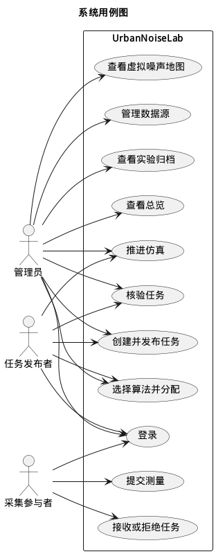

# 第 4 章 系统总体架构

## 4.1 进程与模块

运行时是两个进程。浏览器访问 Vite 开发服务器，前端把 `/api` 代理到 FastAPI。FastAPI 使用 SQLAlchemy 和本地 SQLite。算法不单独占一个进程，预测和分配在 API 进程内调用 `urbannoise` 包。实验脚本可以不启动 Web，直接调用同一套 `run_episode`。

图 4-1 是总体结构。图 4-2 是数据从文件到回合的流向。图 4-3 是不使用 Docker 的部署：Windows 与 Linux 都是虚拟环境、npm 和本机 SQLite。

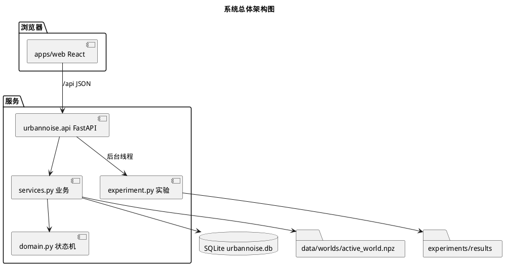

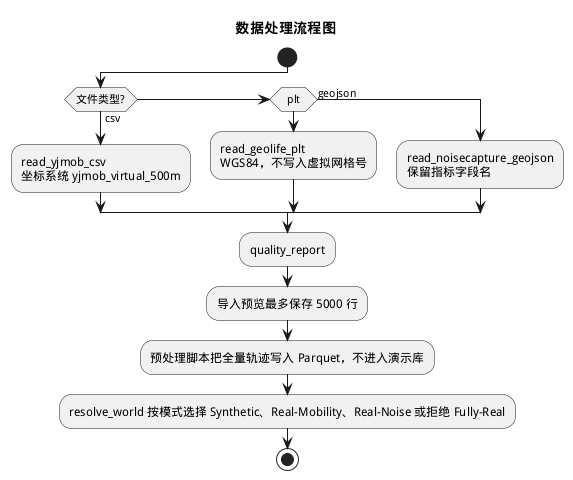

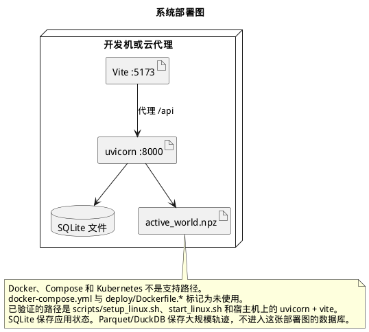

主要 Python 模块：

| 模块 | 职责 |
| --- | --- |
| api.py | HTTP 路由、依赖注入、错误码 |
| models.py | 用户、任务、观测、参与者等表 |
| domain.py | 状态机与权限 |
| world.py | 合成世界与真值场 |
| scenarios.py | real_mobility、fully_real 和数据源校验 |
| predictors.py | 移动分布、IDW、一步方差下降 |
| assignment.py | 各方法的配对分数和贪心选择 |
| experiment.py | 公平种子、回合、汇总 |
| services.py | 把回合步骤接到数据库和时钟 |
| information 路径 | eer 的价值在 predictors.expected_error_reduction |

前端在 `apps/web`，React、TypeScript、Vite、Tailwind 和 ECharts。地图是 canvas 上的虚拟网格，不是第三方底图。YJMob 没有经纬度，不能套到街道图上。

## 4.2 数据库

图 4-4 是 ER 图。SQLite 由 `create_all` 建表，phase2 增加了迁移模块，用来给已有库补列，而不是假设每次都删库。任务表保存状态、执行者、目标格、时间片、到达概率和分数。观测表保存坐标、分贝、时间片和来源标记。用户表保存角色和口令哈希，哈希是 PBKDF2，令牌是 HS256 JWT。

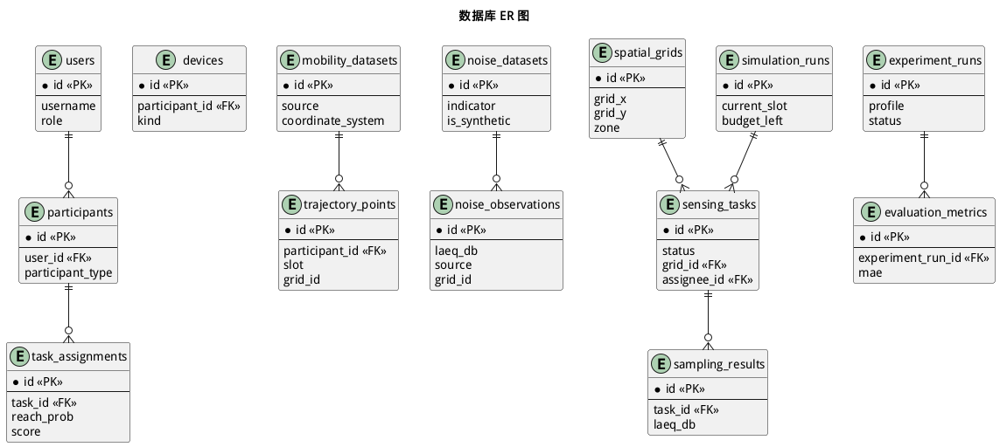

图 4-5 是与代码对应的类。World 持有网格、轨迹和声级真值。ObsSet 只追加已经发生的测量。分配函数返回分数矩阵，不直接写数据库。服务层负责把选中的配对写成任务行。

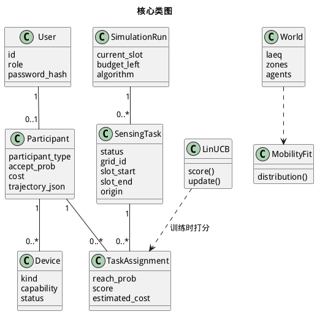

## 4.3 任务状态机

合法主链是 draft、published、assigned、accepted、in_progress、submitted、verified、completed。侧状态是 rejected、expired、failed、cancelled、reassigned。expired、completed、cancelled 没有出边。submitted 可以由 publisher、admin 或 system 核验。collector 提交时必须带测量，并且只能操作分配给自己的任务。过期要求当前时间片已经晚于任务窗口。

图 4-6 按 `TRANSITIONS` 画出主链和侧状态。代码里一共 27 条有向边。图是示意，边的集合以 `domain.py` 为准。

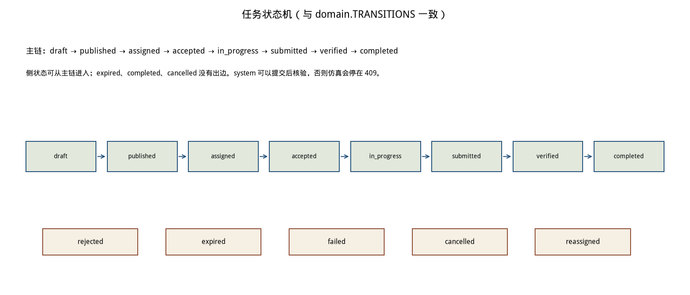

## 4.4 一次采样和一次重规划

图 4-7 是采样时序。发布或自动分配产生任务，时钟到达目标片，执行层读取该人在该片的轨迹格。相等且接受，才写观测。图 4-8 是动态重规划：下一片的计划用当时的观测和轨迹，而不是回合开始时的一批计划一直用到底。消融里的 `mupsa_no_replan` 会关掉重规划。公平主表使用的是带重规划的方法名。

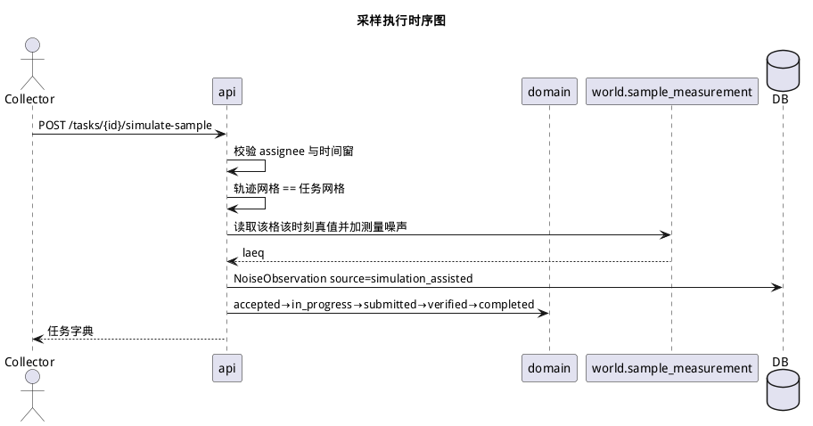

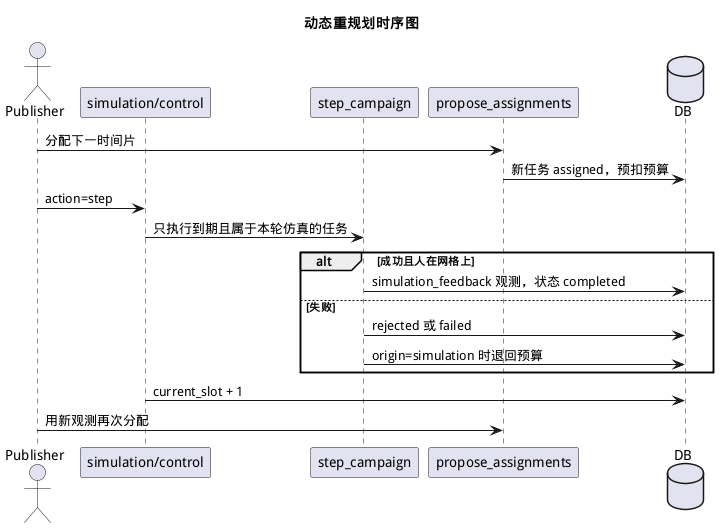

## 4.5 环境种子

旧实现把预算和方法名编进回合种子，导致不同方法看到不同的先验观测。该错误已从公平协议中移除。现在 `env_seed` 只依赖场景、子集、时间范围和种子。算法自己的探索使用另一条种子。接受随机数和测量噪声是环境种子、参与者、时间和对象的 SHA-256，不消耗算法随机流。因此比较方法时，差的是决策，不是世界。

预算不重抽世界。第 9 章里若干方法在预算 4、8、12 上的成功次数完全相同，说明增加的预算没有变成新的成功观测。这是结果，不是绘图错误。

# 第 5 章 真实数据集与预处理

本章区分三层数据。

全量归档：下载下来并被质量报告计数的原始文件。YJMob 两个 csv.gz、GeoLife 的 zip、NoiseCapture 的国家 zip。这些压缩包不在 Git 里。

本机处理后的表：`data/processed` 下的 parquet。Git 忽略它们。本报告的图从这些文件现算。

算法子集：真正进入 `run_episode` 或 IDW 留出的行。人数是 8 或 10，噪声留出最多 4000 加 1500。把全量行数说成实验样本量是错误的。

## 5.1 下载与校验

完整清单在 `docs/data/full_archive/dataset_download_report.md`，由 `cursor/phase2-data-63b5` 的下载脚本写出，并复制进本报告目录的归档说明。失败次数是 1。失败项是 `http://data.noise-planet.org/dump/`：HTTP 200，但正文是 Jetty 上的 Metabase HTML，没有 zip 链接。国家文件改从 `https://data.noise-planet.org/dump/{Country}.zip` 获取。227 个国家归档被解析，解析错误 0。

YJMob 与 Zenodo 记录 10836269 的官方 MD5 比对如下。

| 文件 | 字节 | MD5 | SHA-256 前 16 位 |
| --- | --- | --- | --- |
| dataset1.csv.gz | 419026821 | 3781f6f03a118b5f639bdb4f94dcfdb8 | fdf3d6bc8415debd |
| dataset2.csv.gz | 111175823 | ec769fafa7a746caa3d48d2844b9735c | f477b3defb9511f8 |
| cell_POIcat.csv.gz | 见清单 | 见清单 | 见清单 |

GeoLife zip 为 313164406 字节，MD5 `8ed344eeb6ffccc30da112d824f3fe21`。官方页面没有提供可核对的 SHA-256，ETag 不当成内容哈希。

许可证：YJMob 的 Zenodo 字段是 cc-by-4.0。GeoLife 用户指南给出的是 MSR-LA 非商业研究许可。NoiseCapture 227 个归档的 README 都提到 ODbL，README 文本中都不含 `lden`。本仓库不附带这些许可证的替代解释。

## 5.2 YJMob100K

解析列是 `uid,d,t,x,y`。处理后的 parquet 列名是 `user_id, day, timeslot, x, y`。没有纬度，没有经度，坐标系统写成 `yjmob_virtual_500m`。数据论文和 Zenodo 说明是字段含义的来源，行数以下面的解析为准，没有用网页简介替换。

| 集合 | 行 | 用户 | 天 | 时间片 | x,y |
| --- | --- | --- | --- | --- | --- |
| Dataset 1 | 111535175 | 100000 | 0–74 | 0–47 | 1–200 |
| Dataset 2 | 29389749 | 25000 | 0–74 | 0–47 | 1–200 |

两个文件的用户交集是 25000，也就是 Dataset 2 的用户全部出现在 Dataset 1。空值和越出 1–200 的行都是 0。`(user, day, timeslot)` 没有重复键。缺失发生在用户–天内部的时间片，不是文件损坏：Dataset 1 在已观测的用户–天里，按全局时间片集合计算的缺测组合是 231550537。这是稀疏轨迹，不是稠密的 75×48 矩阵。

最低 uid 的导出子集，不是算法窗口：Dataset 1 的 10、100、1000 人分别有 15718、134306、1228051 行。Dataset 2 对应 16256、136175、1261183 行。

图 5-1 是 Dataset 1 第 0 天全部用户的到访次数，颜色是 log10(次数+1)。热点沿网格呈带状，左下有大片空白。这是匿名网格上的计数，不能解读成某座城市的道路。图 5-2 是 75 天合计的时间片直方图，48 个半小时槽的记录量都在数百万级，没有某一个槽为空。

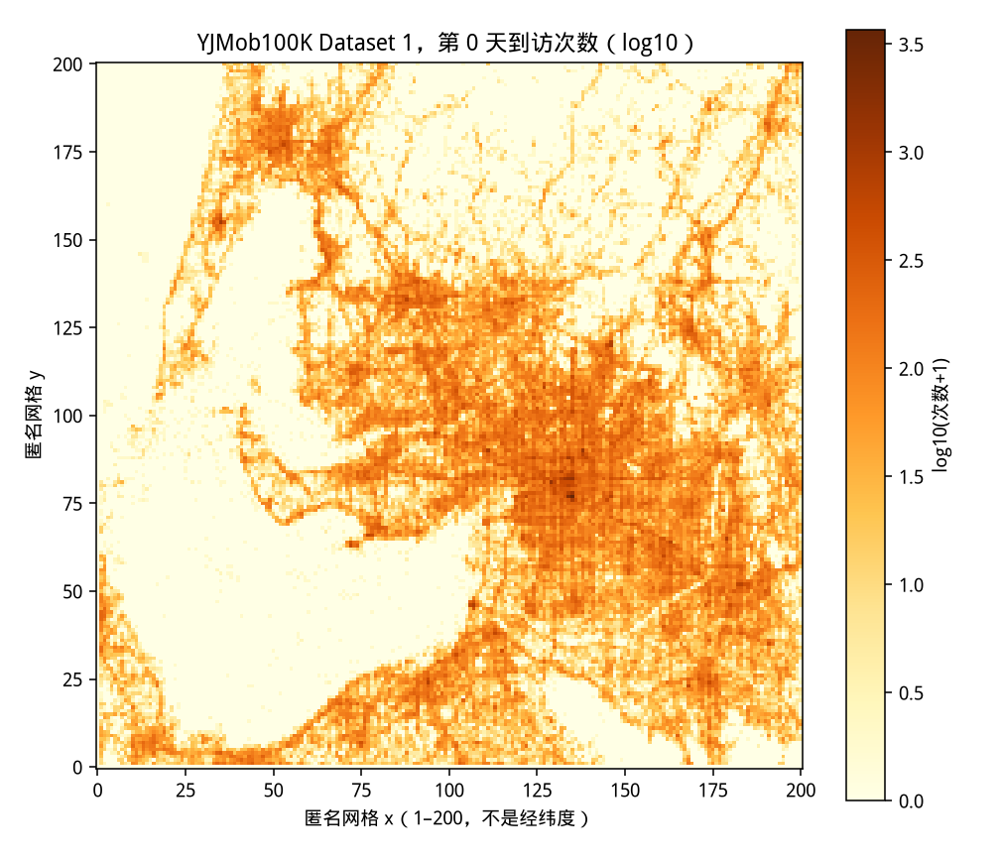

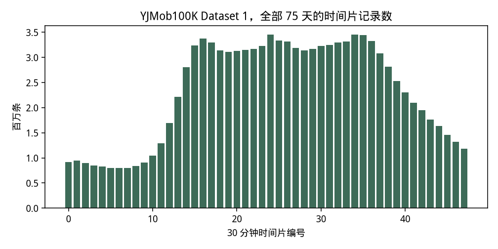

进入算法的不是这张全图。三个窗口都是 24×24、96 个时间片、10 个真实用户、1 台合成机器、合成噪声场。用户按数值顺序候选，再取窗口内最密的一段。

Dataset 1，第 0–1 天，窗口 125 行。用户是 1、102、105、116、120、124、130、134、144、153。

Dataset 2 早期，第 0–1 天，窗口 114 行。用户是 10、103、117、119、122、123、126、13、140、144。

Dataset 2，第 60–61 天，窗口 134 行。用户是 0、10、103、104、109、113、115、117、119、122。

125 行相对 1.11 亿行，是百万分之一量级。结论不能外推到全部用户。POI 文件有 221159 行、85 个类别，本轮分配实验没有使用 POI。

## 5.3 GeoLife

本机 `summary.json`：18670 个 plt，182 个用户目录，24876978 个点，84742 个半小时箱。时间从 2000-01-01T23:12:19 到 2012-07-27T08:31:20。原始包围盒纬度最大值是 400.166666666667，这不是合法纬度。半小时箱使用过滤后的范围，纬度约 1.234 到 64.752，经度约 −176.200 到 175.619。坐标系统 WGS84。箱的生成是同一用户、同一日历日、同一 30 分钟槽内的经纬度平均。

数据分支的质量报告对同一次全量解析还给出接受与拒绝：接受 24173770，拒绝 703208，其中不可能跳跃 209814、重复时间戳 493393、坏坐标 1。海拔 −777 的点被保留并计数 55484。这些拒绝数属于那次预处理报告，用来说明原始点不是全部可用。用户指南中的轨迹条数和总里程不是这里的数字。本报告不把 18670 个 plt 说成用户指南里的轨迹条数。

全局最忙的两天是 2009-02-14 与 2009-02-15，544 行、32 个用户，写在 `slots.parquet`。算法没有使用这两天。算法使用 2008-11-01 与 2008-11-02，8 个用户（001–005、007–009），165 行。请求 10 人时，窗口里点数够的只有 8 人。网格是以该子集最小纬度、经度做原点的 500 米等距圆柱投影，地球半径 6371000 米。没有写成某个城市名。

图 5-3 只画纬度 39.4–40.6、经度 115.7–117.2 的半小时箱，共 71932 个。这是北京附近的空间过滤，用来看轨迹形状。它不是 8 人实验子集，也没有把坏纬度 400 画进去。

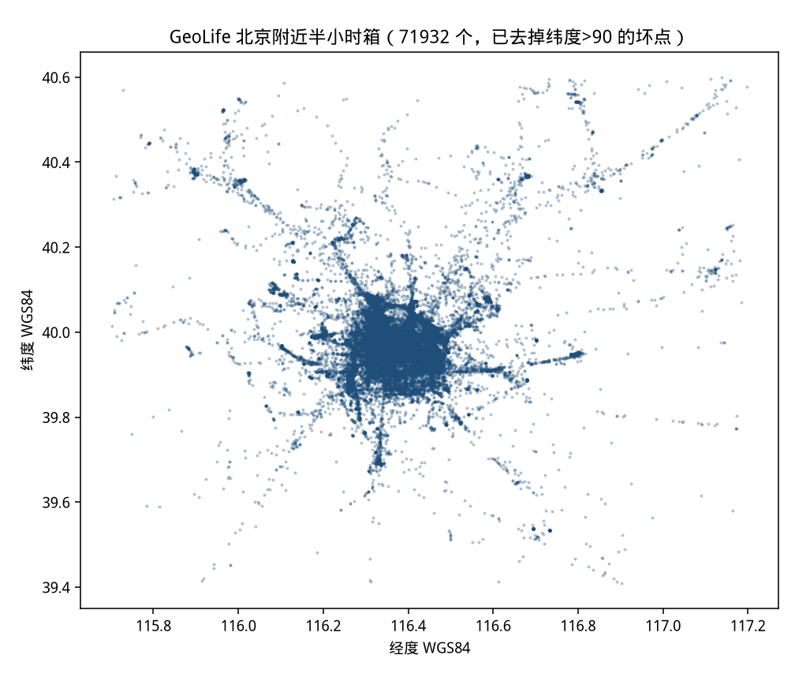

## 5.4 NoiseCapture

两套计数不能相加。

227 国全量解析：点要素 158222603，轨迹 511161，区域 2395782，解析错误 0。点的 noise_level 从 −56.7613 到 150，能量平均 94.704 dB，算术平均 59.0285 dB。两者差了约 36 dB，说明不能用算术平均代替能量平均。区域的 lden 共 2395782 条，全部为 0。lden 不进入任何模型。轨迹级 noise_level 与其点的能量平均，在 507292 条轨迹上的平均绝对差是 0.847 dB，最大差 59.044 dB。点和轨迹仍然分开存放。

本机 16 国点表 `points_laeq_1s.parquet` 共 62293431 行。法国 29116920 行，分贝范围 −39.768 到 129.683。这 2900 万行没有进入预测器。

进入预测和地图的是 `hourly_500m.parquet`，204121 行，16 个国家。列包括 country、indicator、grid、hour_epoch、level_db、n_points、latitude、longitude。level_db 全表最小 −5.162，最大 147.359，负值 2 条，恰好为 0 的 271 条，大于 140 的 5 条。图 5-4 是国家小时箱数量。法国 114182 占多数，卢森堡只有 204。图 5-5 从法国小时箱里抽 35–95 dB 的点，图上实际画出 4276 个。色标是 laeq_1s 的能量平均。0 dB 和超过 140 dB 被排除在这张图之外，但没有从原始表删除。图 5-6 是法国 20–110 dB 小时箱按 `hour_epoch % 24` 的中位数。取模没有做时区校正，所以它不是巴黎当地时间的昼夜曲线，只说明小时箱不是常数。

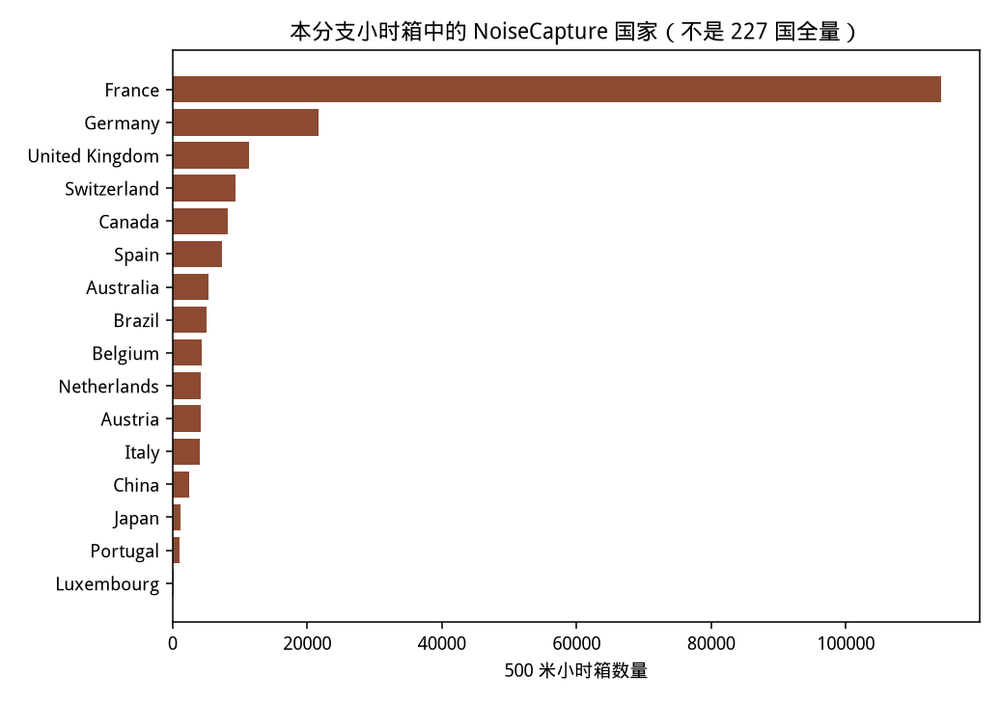

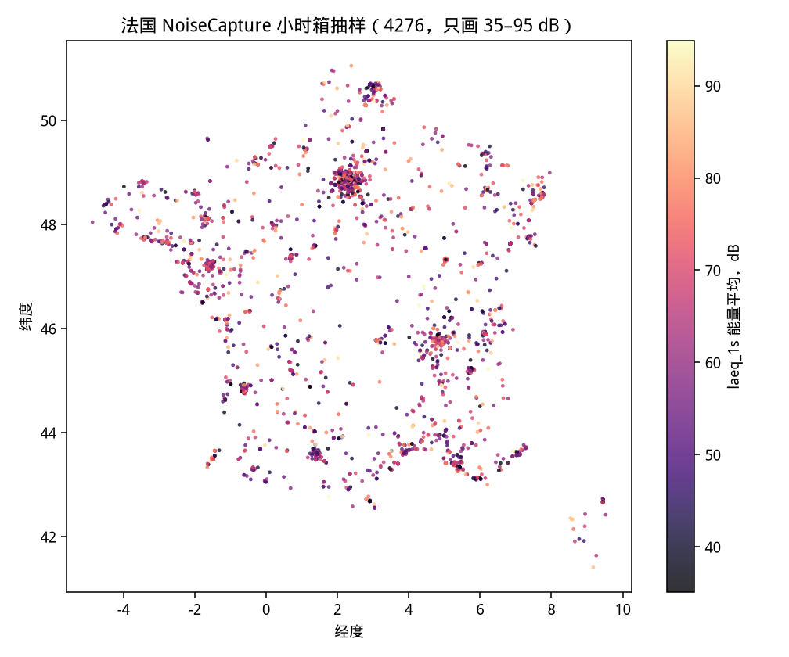

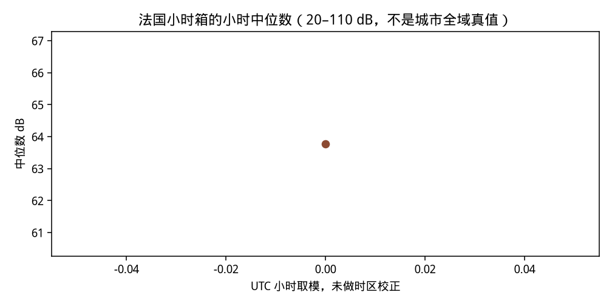

## 5.5 合成噪声

合成世界由 `build_world` 生成。它有完整的真值场，只在测量成功时加上传感器噪声写入观测，并在回合结束后计算误差。图 5-7 是种子 7、16×16、complex 场景、第 8 个时间片的干净真值。这张图不是 YJMob，也不是 NoiseCapture。公平主实验用的是 8×8、2 天、每天 6 个时间片，和第 5-7 的展示网格不同。展示图只说明合成场有空间结构。

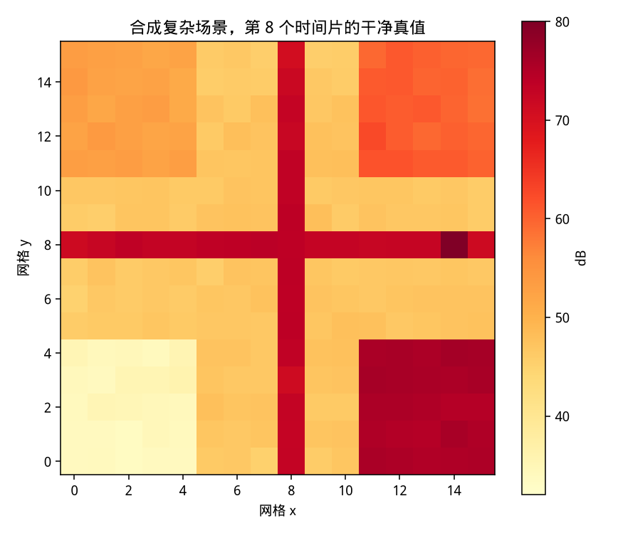

## 5.6 为什么没有 Fully-Real

`experiments/results/phase2/real_runs.json` 的 `fully_real.feasible` 是 false。原因是没有一个国家的 NoiseCapture 时间与 GeoLife 时间相交。GeoLife 止于 2012-07-27。清单里的国家开始于 2015 或更晚，例如法国点测量从 2015 年起，卢森堡小时箱从 2016-11-29 起。空间包围盒经常相交，时间不相交。接口因此返回 409，文案拒绝把 YJMob 的 x、y 配准到 WGS84。不存在一个“把两个数据集拼在一张图上”的 Fully-Real 实验。

## 5.7 训练、测试与子集依据

合成实验的评估期是世界的第二个时段，决策只用该时点之前的观测。先验观测由环境种子抽取，方法之间共享。

真实移动实验没有真实噪声真值，所以误差是合成场上的误差。窗口选择规则是“候选用户里最密的两天”，写在结果 JSON 的 `window_rule=densest_window`。它偏向轨迹较密的人，不代表随机用户。

噪声预测是时间留出：按 hour_epoch 的 0.7 分位切开，SQL 中最多取 4000 条训练和 1500 条测试。法国输入小时箱 114182，实际训练 4000、测试 1500。卢森堡输入 204，训练 143、测试 61。这是手机测量对手机测量，不是对城市全域场。

# 第 6 章 核心算法原理与设计

本章公式与 `predictors.py`、`assignment.py`、`experiment.py` 一致。没有实现的方法不写公式。

图 6-1 是算法总流程：可见历史、移动分布、IDW、价值、配对分数、贪心选择、执行、评估。

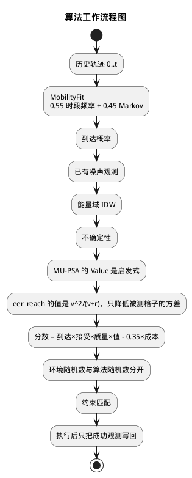

## 6.1 人类未来位置

问题：在目标时间片，这个人出现在每个格子的概率是多少。只使用目标片之前的轨迹。

设该人在目标片的日内槽位上的历史计数为 c(g)。若计数和为正，P_tod(g) = c(g) / Σ c。否则退回该人全部历史频率。若仍为空，则均匀分布。

若当前位置已知且转移计数允许一步滚动，则从当前位置出发做 lead 步转移，得到 P_roll。网格数不超过 768 时使用稠密转移矩阵，没人离开过的行退回频率。混合是

P(g) = 0.55 P_tod(g) + 0.45 P_roll(g)

再归一化。没有滚动时，P = P_tod。权重 0.55 和 0.45 写在 `MobilityFit.distribution`，没有在本报告的实验里搜索过。

到达矩阵的第 i 行就是参与者 i 的这个分布，记为 P_reach(i, g)。真实轨迹实验里，成功与否不看这个概率，而看存储的未来格子是否等于任务格。概率只影响派给谁。

局限：半小时槽上的频率加一阶转移，不能表示长程通勤，也不能表示“人会为了任务改道”。Top-1、Top-3、NLL 和 Brier 的计算函数在 `evaluate_mobility`，公平主配置把 `model_reports` 设成 false，所以第 9 章没有一组新的移动精度数字。不能把函数存在写成已经测出了高精度。

## 6.2 噪声的时空预测

问题：给定已经发生的观测，估计每个格子在目标时间的声级。

观测为空时，预测是常数 55 dB，不确定度是常数 12 dB。这是缺数据时的占位，不是城市背景噪声的测量。

否则对每个查询格子，与观测的距离是

d = 空间欧氏距离 + 0.55 × 日内时间片的环形距离 + 3.5 × 用地不同指示

用地惩罚只用已知的 zone 图，不用噪声真值。取最近的 k 个观测，k 默认 8。权重是 1 / max(d, 0.35)^2。声级先变成能量 e = 10^(L/10)，加权平均后再变回分贝。不确定度由能量域加权方差经 delta method 换到分贝，并有下限 0.35 + 0.5 × 最近空间距离，最后裁剪到 0.35–15。因此不确定度没有校准成经验覆盖率。主结果表里的 interval_coverage 不能解释成 95% 置信区间的覆盖。

局限：IDW 不是高斯过程。邻居以外的相关被丢掉。法国留出上的负 R² 说明，在这个采样下它不如均值。

## 6.3 预测不确定度

不确定度是上一节的 std，不是互信息，也不是期望地图误差。`cell_features` 另算隔离度、时间缺口和重复惩罚，供 MU-PSA 使用。eer 路径不使用这些启发式项。

## 6.4 采样信息价值

MU-PSA 的价值是启发式。记归一化不确定度为 u，覆盖缺口为 exp(−次数) + 0.5 × 隔离，时间缺口为 t，重复为 d。则

V = 1.0 u + 0.65 覆盖 + 0.25 t − 0.8 d

系数在 `combine_value` 的默认权重里。mode 可以关掉不确定度或覆盖，供消融。这不是互信息。

eer 的价值是一步方差下降。设预测标准差为 s，传感器标准差为 σ，方差 v = s^2，测量噪声 r = σ^2。后验方差是 v r / (v+r)，下降量是

Δ = v^2 / (v + r)

代码是 `(var * var) / (var + noise + 1e-12)`。它只更新被测格子自己的方差，不把相关格子的方差一起减掉。传入的噪声场若存在，这个函数也不读取。所以它不是“在真实场上的期望绝对误差下降”，而是对角方差启发式。

## 6.5 到达、接受与质量

参与者带有 accept、quality、cost、online。成功概率在分数里写成

P_success = P_reach × accept × quality

执行时，接受与否由环境种子的均匀随机数和 accept 比较，机器的测量噪声标准差乘 0.75。quality 因此出现在排序里，但执行成功的布尔条件是“到达且接受且在线”，quality 不单独再掷一次骰子。这个不一致是实现事实：质量改变了谁被选中，没有改变选中之后的成败判定。

真实数据没有接受或拒绝标签。accept 是场景参数，默认 0.72。把它说成从数据学到的接受率是错的。

## 6.6 分配分数

在线参与者和格子配对。`min_reach` 默认 0.22。空间可行指当前距离在阈值内。各方法：

| 方法 | 分数 | 约束 |
| --- | --- | --- |
| nearest | −当前距离 | 空间可行或到达超过阈值 |
| reach_nearest | P_reach | P_reach ≥ 0.22 |
| reach_random | 算法随机数 | 同上 |
| reach_greedy | P_reach × V | 同上，V 为启发式价值 |
| greedy | V − 0.03 × 距离 | 空间可行 |
| uncertainty | u − 0.03 × 距离 | 空间可行 |
| min_cost | −(cost + 0.12 × min(距离, 30)) | 空间或到达 |
| mupsa | P_success × V − 0.35 × cost | 无到达硬阈值 |
| eer_reach | P_success × Δ − 0.35 × cost | P_reach ≥ 0.22 |
| bandit | 与 mupsa 同一分数式，选择由 LinUCB 影响 | 见下节 |

eer 的消融：eer_no_reach 去掉 P_reach，仍保留 accept 和 quality；eer_no_accept 去掉 accept 和 quality，保留 P_reach；eer_no_cost 去掉成本项。选择是贪心，每人每片至多一个任务，并受每片人数上限和预算约束。

## 6.7 动态重规划

默认每个决策时点用当时的 `decision_context` 为 lead=1 的目标片做一批计划。时钟走到该片就执行。下一次决策看到新观测。`mupsa_no_replan` 只在评估期开始做一批，之后不再计划。公平主表没有把 no_replan 列进方法列表。

## 6.8 LinUCB

bandit 使用 LinUCB，探索系数 alpha 在公平配置里是 0.75，正式比较前有 2 个训练回合。上下文是配对的到达、距离、价值、不确定度、重复、预算比例和时间比例，维度由 `pair_context` 固定。它不是 PPO，也不是 DQN。训练回合短，第 9 章看到它的成功次数停在 1，增加预算没有增加成功。这和“强化学习已经学会分配”不是一回事。

旧测试分支记录过一个缺陷：LinUCB 仍可能选中到达概率为 0 的配对，因为 UCB 的乐观项盖过了很负的距离分。本分支的公平主表没有单独把该缺陷标成已修复。bandit 的平均到达概率约 0.15，低于 eer_reach。报告不声称这个缺陷已经消失。

## 6.9 伪代码

下面的伪代码对应 `run_episode` 加 `step_campaign`，省略了日志字段。

```
env = hash(scenario, subset, time, seed)
world = build(env)
obs = prior(env)
for slot in horizon:
    ctx = features(obs up to slot-1, traj up to slot-1)
    plans += greedy(scores(method, ctx), budget)
    for task due at slot:
        reached = traj[person, slot] == task.cell
        accepted = online and draw(env, slot, person) < accept
        if reached and accepted:
            obs.add(truth[slot, cell] + noise(env))
score MAE using truth and the predictions from past obs
```

代码位置：`experiment.py` 的 `run_episode`、`step_campaign`、`decision_context`；`predictors.py` 的 `predict_idw` 与 `expected_error_reduction`；`assignment.py` 的分数循环。

## 6.10 理论和工程局限

没有次模证明。没有空间协方差，所以“测一个点降低邻域误差”只发生在 IDW 的事后预测里，不发生在 eer 的打分里。接受概率是常数。真实移动实验的噪声场是合成的，MAE 回答的是“在假噪声上，真实脚印能不能采到有用的点”，不是“真实城市噪声被预测准了”。

# 第 7 章 系统详细设计与实现

## 7.1 数据管理

数据页列出已登记的文件、坐标系统和行数摘要。图 7-1 的浏览器画面在切换仿真之前停在数据页，脚本等待页面出现 `yjmob100k-dataset1.csv.gz` 才截图。因此这张图不是摆拍的静态稿，而是当时 API 已经返回了该文件名。

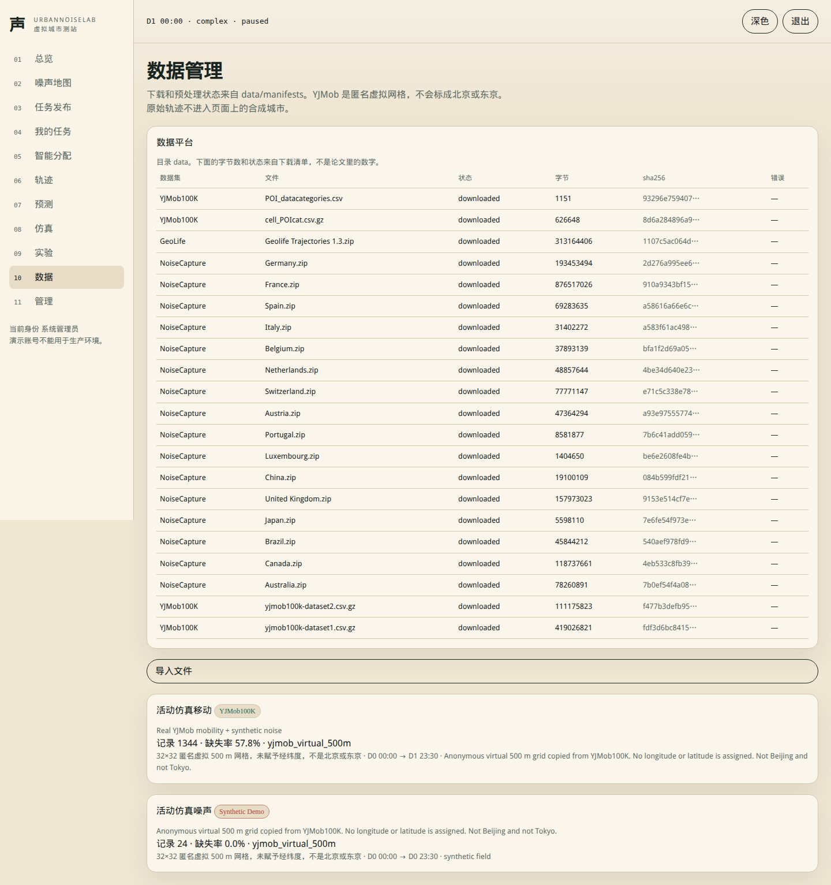

导入器按列名读取。YJMob 只接受 x、y。GeoLife 的 plt 跳过 6 行表头。NoiseCapture 的指标分列。缺少必需列时接口报错，不补一列假的经纬度。

## 7.2 用户与会话

登录页提供三个演示身份按钮。图 7-2 是点击管理员之前的画面。登录后 JWT 附在 `/api` 请求上。口令以 PBKDF2 存储。生产部署必须更换口令和 `UNLAB_JWT_SECRET`。


## 7.3 总览、发布与分配

总览读取当前世界的人数、预算和时间片，不单独维护一套展示用数字。图 7-3 是总览。

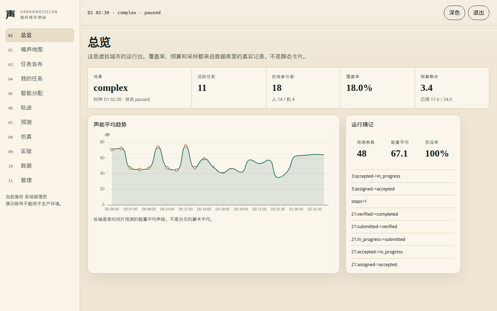

发布流程见图 7-4 的活动图和图 7-5 的页面。发布者填写时间片、格子和说明，状态从 draft 到 published。自动分配的活动图是图 7-6，页面是图 7-7。分配结果写回任务的执行者、分数和到达概率。采集者在自己的任务列表里接受或提交。图 7-8 是采集者看到的地图，图例仍标明匿名网格不是城市底图。

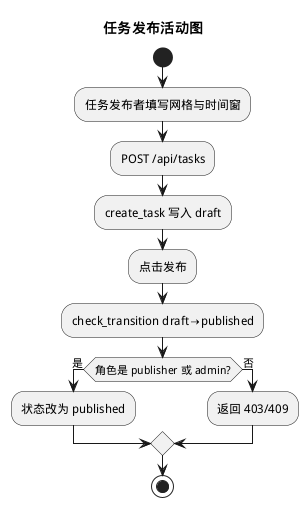

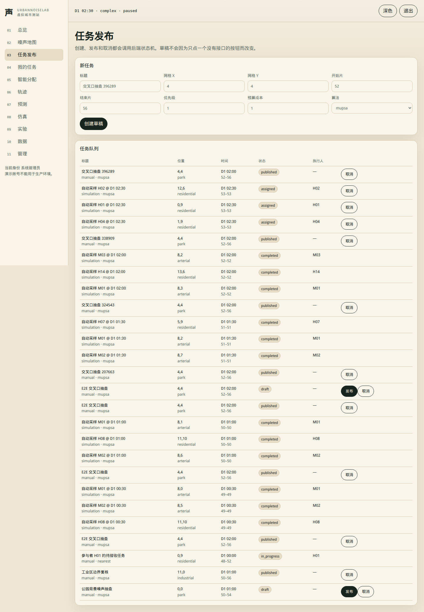

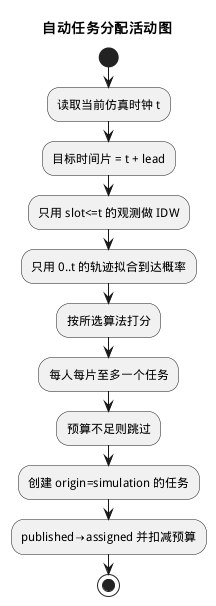

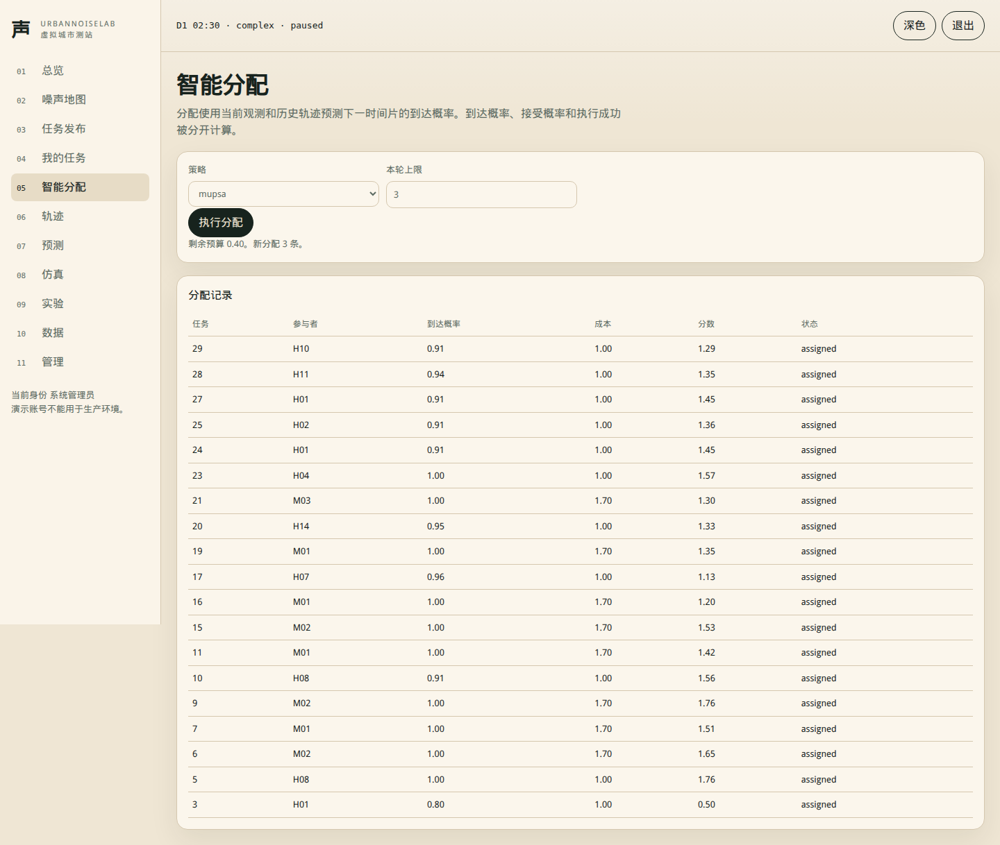

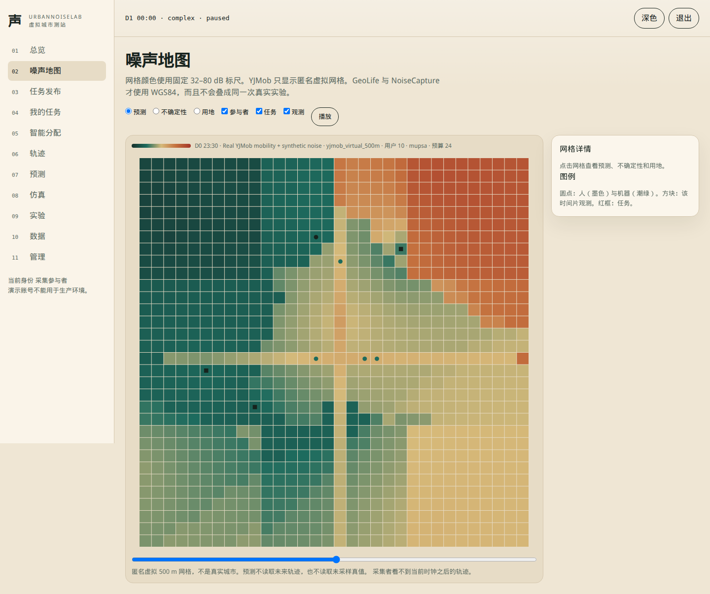

## 7.4 仿真控制

仿真重置会按所选数据源重建世界，而不是只改标签。图 7-9 的状态行是：来源 real_mobility，移动 YJMob100K，噪声 synthetic_field，用户 10。算法 mupsa，预算还剩 24，已花费 0，时钟停在评估期第一天的起点，所以当前片 MAE 尚未计算。

这张图证明的是数据源切换和诚实的空状态。它使用的种子是 7，场景 complex，预算 24，机器数 4。第 9 章的公平主实验是种子 0–2、8×8、预算 4/8/12、人机数量按配置文件。不能把这张截图上的预算 24 当成实验表里的一个点。


另一条浏览器记录来自分支 `cursor/phase2-simcheck-63b5`。那里的 real_mobility 点击打到的是模式符合、但是夹具回退的数据，`fixture_fallback` 为真，不是下载的 YJMob parquet。图 7-10 只说明下拉和重置请求没有把失败显示成成功。图 7-11 是 fully_real 的 409：页面留下拒绝原因，没有改写成已完成的真实实验。PR #2 的 YJMob 证据以图 7-9 和图 7-12 为准，不以图 7-10 为准。


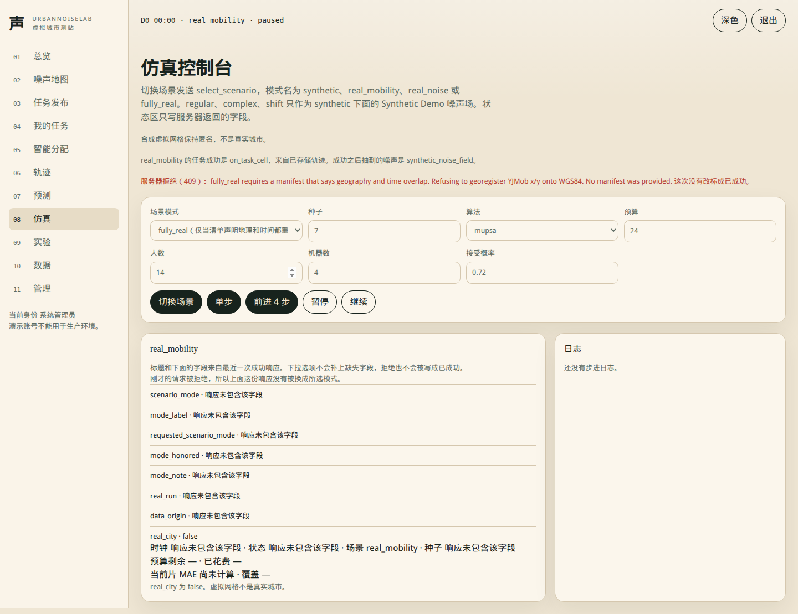

## 7.5 地图与实验页

图 7-12 与图 7-9 是同一次重置之后的地图。标题写明 Real YJMob mobility + synthetic noise，坐标 yjmob_virtual_500m，用户 10，预算 24。色标固定 32–80 dB。图层有预测、不确定度、用地、参与者、任务和观测。评估真值默认关闭。底部说明预测不读取未来轨迹，也不读取采样真值。圆点是人，方块是该时间片的机器观测，红框是任务。

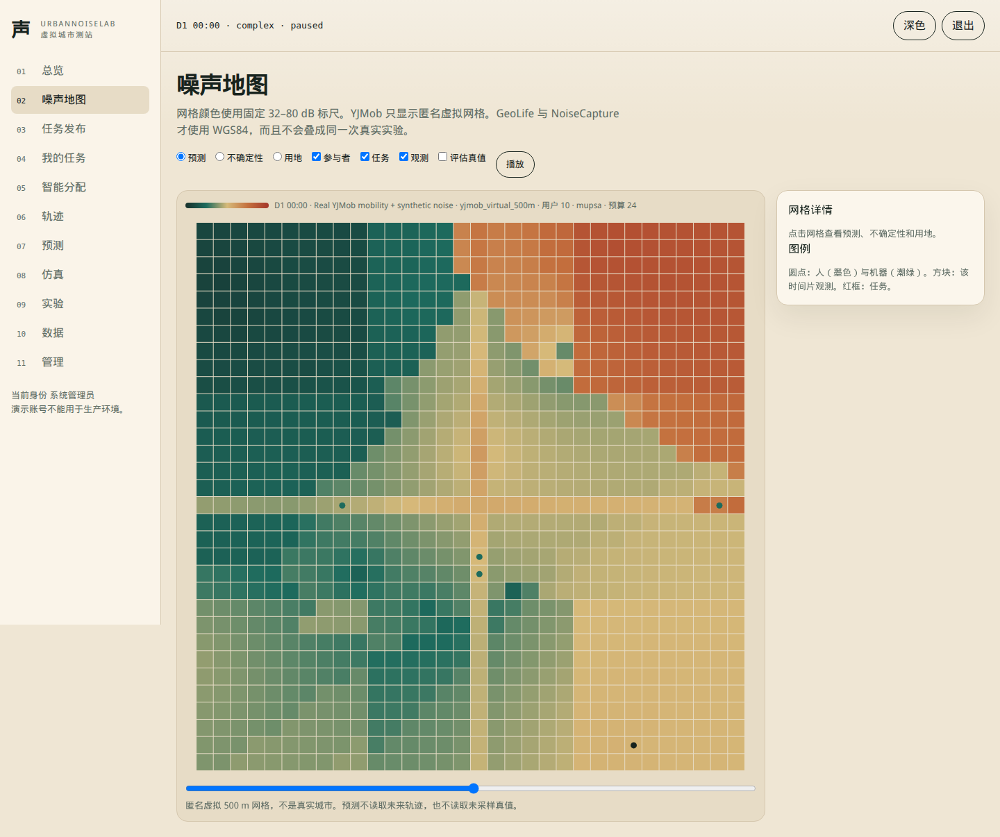

实验页读取结果文件中的方法对比。图 7-13 是实验中心。曲线的数值以第 9 章的 JSON 为准；若页面四舍五入和 JSON 差在显示位数，以 JSON 为准。

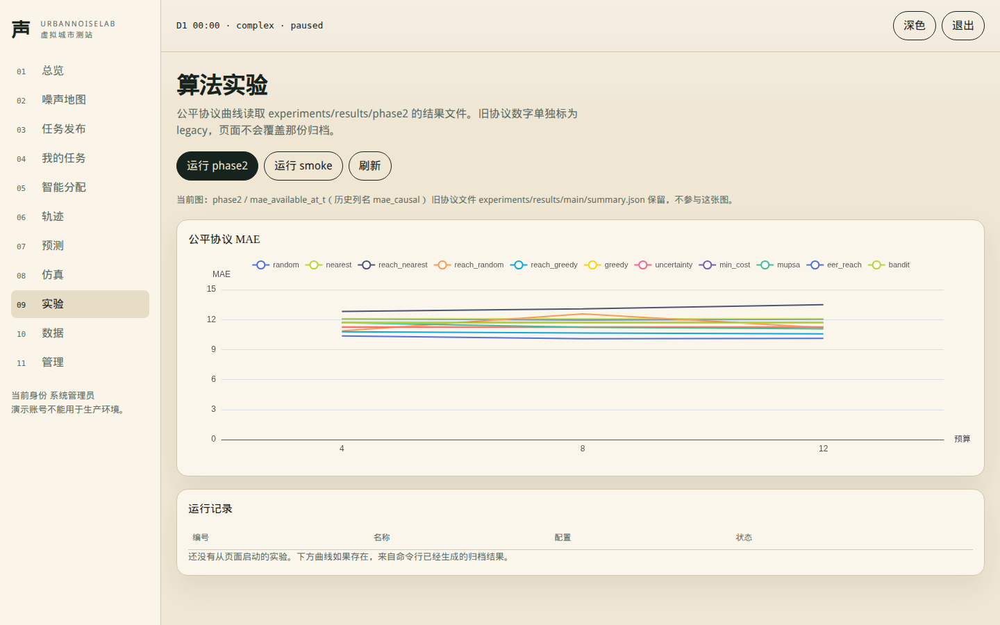

## 7.6 关键接口

健康检查是 `GET /api/health`。登录是 `POST /api/auth/login`。场景选择会校验数据模式，fully_real 不满足重叠条件时是 409，正文含有 `scenario_unavailable`。任务转移不合法时是 409，正文来自 `TaskStateError`。OpenAPI 在 `/docs`。完整路径以代码里的路由装饰器为准，本报告不另造一套未实现的 REST 资源。

# 第 8 章 前端 UI 与交互

## 8.1 设计

界面是浅色纸面背景、深绿色主按钮和少量赤陶色危险按钮。导航按任务顺序排列：总览、地图、发布、我的任务、分配、轨迹、预测、仿真、实验、数据、管理。时钟、场景和暂停状态留在顶栏，避免每个页面各说一个时间。

地图不是装饰。它消费当前世界的预测数组、参与者坐标和任务格子。YJMob 模式底部明确写“匿名虚拟 500 m 网格，不是真实城市”。GeoLife 与 NoiseCapture 只有在数据源是 WGS84 时才使用经纬度，并且不会和 YJMob 叠成一张“真实实验”图。

## 8.2 交互如何服务于采样

重置、单步和前进四步调用后端时钟。暂停时不消耗预算。图 7-9 在重置后已花费为 0，是因为还没有步进。若步进之后人没有走到任务格，任务失败，地图上的观测层不会增加一个点。这个行为由第 6 章的执行条件决定，前端只显示返回值。

方法下拉的选项来自后端。选择 eer_reach 或 mupsa 会改变下一次自动分配的分数，不会改已经写好的历史结果 JSON。实验页因此和仿真页分开：仿真是当前库里的一场，实验页是已保存的多随机种子汇总。

## 8.3 响应式

图 8-1 是窄宽度下的数据页。侧栏收缩后，数据集名称仍然可见。本报告没有做完整的移动端任务执行走查，所以只把这张图作为布局证据，不作为采集者在手机上完成闭环的证据。

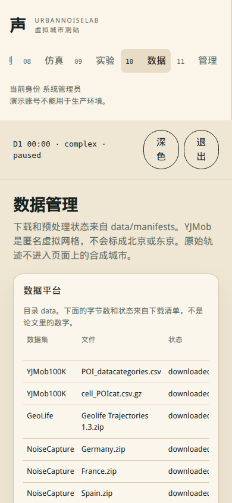

## 8.4 前端实现备注

页面使用 React 与 TypeScript。地图用 canvas 画网格，曲线用 ECharts。样式是 Tailwind。构建工具是 Vite，开发时把 `/api` 代理到 FastAPI。本次交付没有修改这些页面，也没有重新跑浏览器脚本。截图来自仓库里已经提交的 `docs/screenshots`，生成脚本是 `scripts/shoot_phase2.mjs` 和 simcheck 分支上的点击脚本。二者的数据来源不同，第 7 章已经分开。

# 第 9 章 实验设计与结果

## 9.1 协议

公平主实验的配置在 `experiments/results/phase2/fair_main/results.json` 的 `config`：

| 项 | 值 |
| --- | --- |
| 协议 | mae_available_at_t |
| 网格 | 8×8 |
| 天数 × 片 | 2 × 6 |
| 人 / 机器 | 6 / 2 |
| 先验样本 | 8 |
| 传感器 σ | 1.5 dB |
| 人的接受概率 | 0.72 |
| 轨迹缺失率 | 0.04 |
| lead / 每片上限 | 1 / 2 |
| 预算 | 4、8、12 |
| 种子 | 0、1、2 |
| 场景 | regular、complex |
| 消融 | 种子加 50，regular，预算 8 |
| 鲁棒性开关 | false |

鲁棒性不在这张主表里。第 9.8 节是后来按同一 `run_episode` 另跑的 135 个回合，文件分开存放。

指标：MAE 和 RMSE 是评估期每个格子、每个时间片上预测与真值的绝对误差和均方根。覆盖率是成功观测过的格子比例。成功次数是 reason 为 success 的任务数。成本只累计成功任务。平均到达概率是被分配配对的 P_reach 的平均，不是成功率。

没有做配对 t 检验或置信区间修正。n=3 或 n=2。下面的“最低”只表示样本平均的排序。标准差经常大于 1 dB，而方法之间的差距经常小于 1 dB。

## 9.2 合成 regular

图 9-1 是 regular 的 MAE 曲线，图 9-2 是成本与 MAE。数字来自 `summary.json` 的 `mae_causal_mean`，协议说明该列就是 mae_available_at_t。单位 dB，均值 ± 样本标准差，n=3。

| 方法 | 预算 4 | 预算 8 | 预算 12 |
| --- | --- | --- | --- |
| random | 12.065±1.939 | 11.969±1.828 | 12.030±2.063 |
| nearest | 12.065±1.939 | 12.065±1.939 | 12.065±1.939 |
| reach_nearest | 12.806±1.383 | 13.069±0.963 | 13.485±0.889 |
| reach_random | 10.870±1.762 | 12.563±1.618 | 11.194±2.446 |
| reach_greedy | 10.785±2.224 | 10.663±1.866 | 10.568±2.000 |
| greedy | 11.280±2.632 | 11.280±2.632 | 11.280±2.632 |
| uncertainty | 11.234±2.221 | 11.234±2.221 | 11.234±2.221 |
| min_cost | 11.710±2.725 | 11.710±2.725 | 11.710±2.725 |
| mupsa | 11.685±1.682 | 11.224±1.861 | 11.083±2.055 |
| eer_reach | 10.373±1.931 | 10.081±1.965 | 10.124±1.908 |
| bandit | 11.674±1.966 | 11.674±1.966 | 11.674±1.966 |

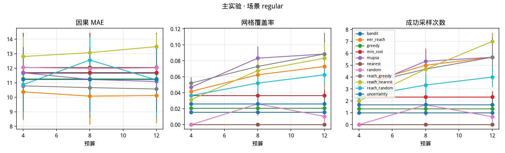

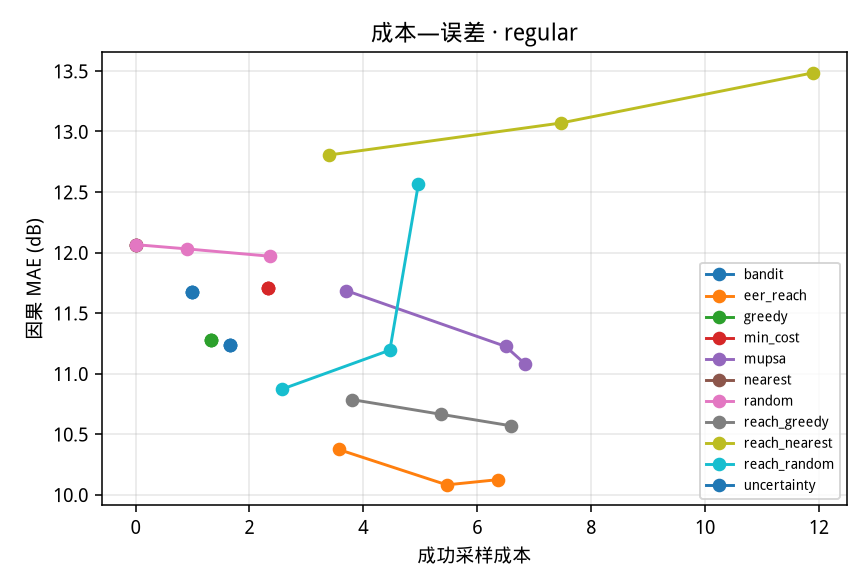

预算 8 时 eer_reach 的平均 MAE 最低。预算 4 也是它最低。预算 12 仍是它最低，但只比预算 8 的 10.081 高到 10.124，没有随着预算继续下降。reach_nearest 在三个预算上都比“几乎不成功的 nearest”更差：预算 12 时它成功 7.00 次、到达概率 1.000、成本 11.90，MAE 却是 13.485。多采到的点提高了误差。nearest 在三个预算上成功次数都是 0，MAE 保持 12.065。它把任务派给当前距离近、但下一片到不了的人。

greedy、uncertainty、min_cost 和 bandit 的成功次数不随预算变化：分别是 1.33、1.67、2.33 和 1.00。额外预算没有变成新的成功观测，所以 MAE 也不变。bandit 的平均到达概率约 0.15。图 9-3 是它的回报曲线，回报没有表现出稳定上升后的更低地图误差。

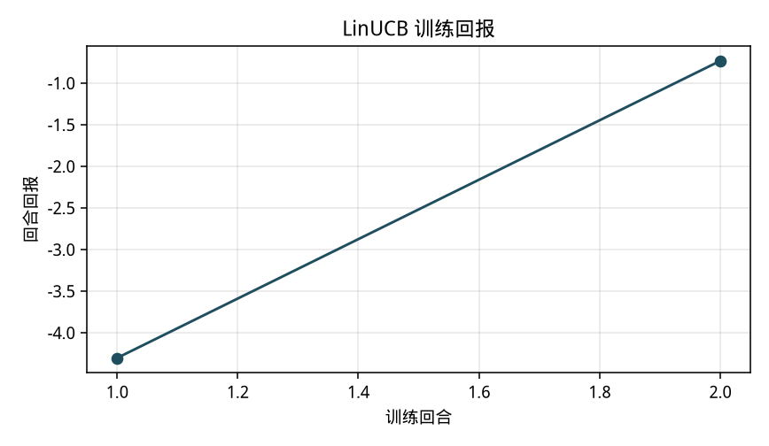

## 9.3 合成 complex

| 方法 | 预算 4 | 预算 8 | 预算 12 |
| --- | --- | --- | --- |
| random | 10.233±1.260 | 10.765±0.984 | 9.685±2.251 |
| nearest | 10.091±0.882 | 10.091±0.882 | 10.091±0.882 |
| reach_nearest | 10.125±1.440 | 10.600±1.706 | 11.204±1.330 |
| reach_random | 9.248±1.668 | 9.968±1.412 | 9.168±2.207 |
| reach_greedy | 9.817±1.400 | 9.343±1.529 | 9.299±1.520 |
| mupsa | 9.507±1.477 | 9.911±1.078 | 9.717±1.050 |
| eer_reach | 9.463±1.576 | 9.294±1.698 | 9.294±1.698 |
| bandit | 10.842±1.750 | 10.842±1.750 | 10.842±1.750 |

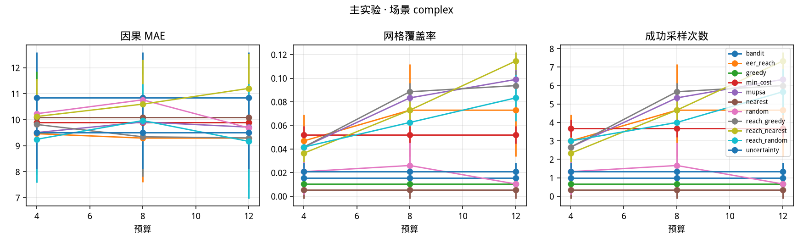

预算 4 的最低平均是 reach_random 9.248，eer_reach 是 9.463，mupsa 是 9.507。预算 8 的最低是 eer_reach 9.294。预算 12 的最低又是 reach_random 9.168。eer_reach 在预算 8 和 12 上平均值相同，都是 9.294，成功次数都是 4.67。预算从 8 加到 12 没有改变它在这三个种子上的评估结果。

reach_nearest 再次出现“成功更多、误差更高”：预算 12 成功 7.33 次，MAE 11.204，高于成功 0.33 次的 nearest（10.091）。

## 9.4 消融

消融种子是 50、51、52，场景 regular，预算 8。世界种子是请求种子加 50，和环境主表的种子 0–2 不是同一个世界。图 9-5 是汇总图。逐种子的 mae_available_at_t 如下。

| 种子 | eer_reach | eer_no_reach | eer_no_accept | eer_no_cost |
| --- | --- | --- | --- | --- |
| 50 | 6.964（成功 6） | 11.075（成功 0） | 6.425（成功 5） | 6.964（成功 6） |
| 51 | 11.854（成功 3） | 13.525（成功 0） | 11.854（成功 3） | 11.854（成功 3） |
| 52 | 10.455（成功 3） | 11.452（成功 0） | 10.172（成功 4） | 10.455（成功 3） |

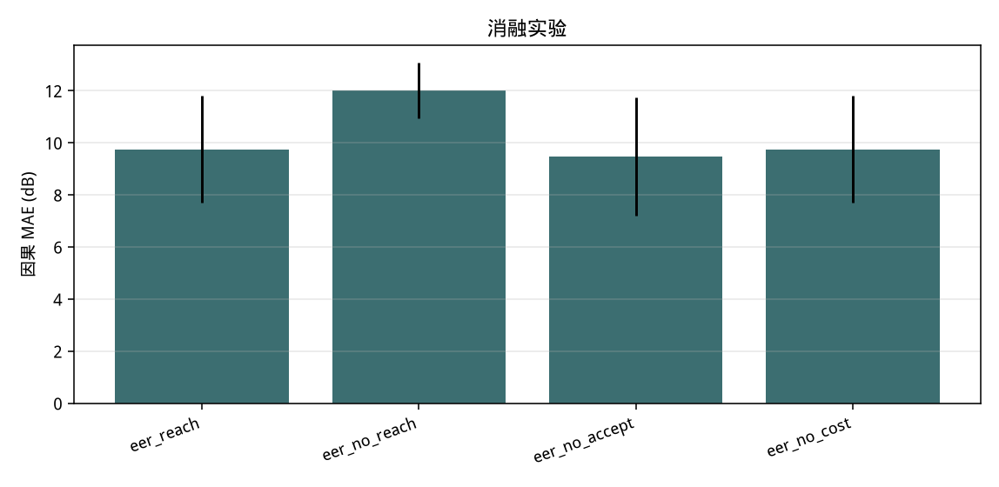

去掉到达概率后，三个种子的成功次数都是 0，MAE 更高。到达约束在这组里是必要的。去掉成本项后，三个种子与完整 eer_reach 完全相同，说明 0.35 的成本权重没有改变这些种子上的选择。去掉接受和质量后，种子 50 和 52 的 MAE 更低，种子 51 相同。完整模型并没有支配这个消融。因此不能写“四项乘积都有贡献”。

## 9.5 真实轨迹，合成噪声

文件 `experiments/results/phase2/real_runs.json`。每个窗口 2 个种子，预算 8，噪声场合成，人的轨迹真实。图 9-6 画出其中五种方法。

| 子集 | 最低方法 | eer_reach | eer 成功 |
| --- | --- | --- | --- |
| YJMob d1 | min_cost 10.162±4.898 | 10.870±4.851 | 4.5 |
| d2 早期 | random 9.657±1.768 | 11.603±1.423 | 4.0 |
| d2 第 60–61 天 | nearest 8.070±0.593 | 9.844±0.287 | 5.0 |
| GeoLife | min_cost 12.239±2.510 | 13.492±1.058 | 4.5 |

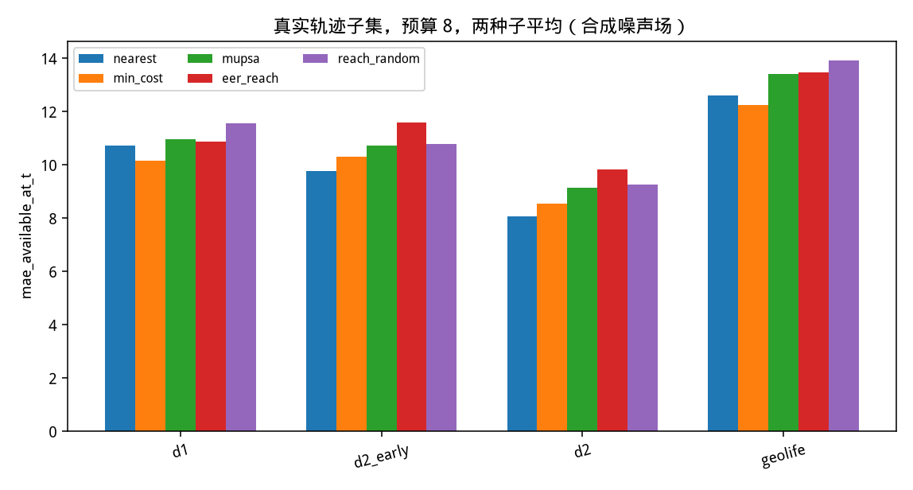

Dataset 1 上 eer_reach 成功 4.5 次，min_cost 成功 1.5 次，但 min_cost 的平均 MAE 更低。Dataset 2 早期，random 的 MAE 最低，eer_reach 在列出的方法里最高。第 60–61 天，nearest 成功 1.5 次、MAE 8.070；eer_reach 和 mupsa 成功 5.0 次，MAE 分别是 9.844 和 9.150。GeoLife 上 min_cost 12.239，mupsa 13.403，eer_reach 13.492，reach_random 13.939。

这四组共同的观察是：在真实脚印加合成噪声上，到达约束提高了成功次数，没有提高地图精度。第 6 章的对角方差没有因为人真实存在就变成空间误差的期望。

GeoLife 的全局最忙窗口（2009-02-14/15，32 人，544 行）没有进入上表。上表是 2008-11-01/02 的 8 个人、165 行。

## 9.6 真实噪声预测

没有参与者，也没有任务。预测器是同一套 IDW，评价对象是留出的手机小时箱。

| 国家 | 输入箱 | 训练 | 测试 | MAE | RMSE | R² |
| --- | --- | --- | --- | --- | --- | --- |
| France | 114182 | 4000 | 1500 | 18.260 | 22.413 | −0.352 |
| Luxembourg | 204 | 143 | 61 | 15.524 | 20.770 | −0.432 |

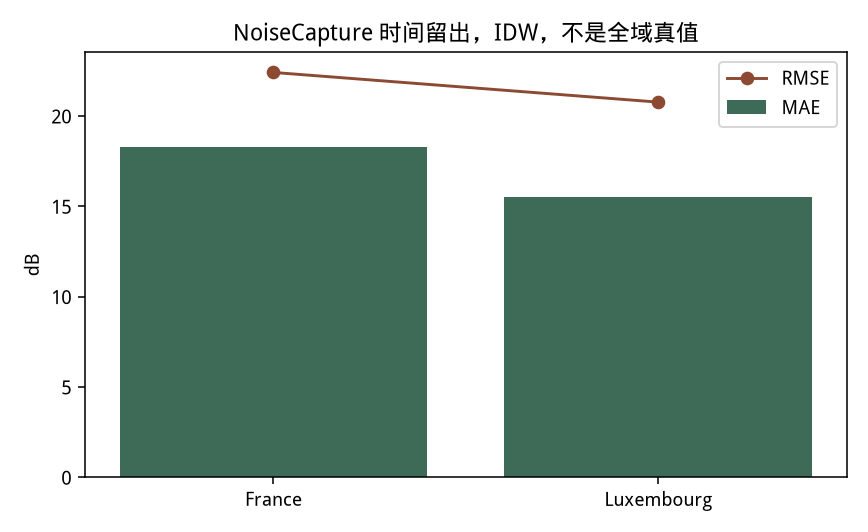

R² 为负，表示残差平方和大于用训练均值做常数预测的残差平方和。IDW 在这个留出上失败了。失败和 16 国小时箱里的 0 dB、负分贝、超过 140 dB 的记录是一致的：输入不是干净的 LAeq 场。法国 2900 万条原始点没有参与这 4000 条训练。

## 9.7 预算、人数与人机混合

预算对比就是第 9.2 和 9.3 节的三列。增加预算并不单调降低 MAE。regular 上 reach_nearest 随预算变差。complex 上 eer_reach 在后两档预算相同。

人数对比在第 9.8 节的 few_participants：2 名人类加 1 台机器，对照是 6 名人类加 2 台机器。人机混合的两个极端是 humans_only 与 machines_only。这些世界的种子是 90–92，不能和主表的种子 0–2 比绝对数值，只能在本表内部比方法。

## 9.8 鲁棒性

命令是 `PYTHONPATH=src .venv/bin/python scripts/run_robust_fair.py`。结果在 `experiments/results/phase2/robust_fair/results.json`。135 个回合，本次墙钟 0.980 秒。网格仍是 8×8，预算 8，每种变体 3 个种子。变体定义与 `experiment.py` 里的鲁棒性列表相同，方法列表增加了 min_cost、eer_reach 和 reach_random。主配置的 `robustness: false` 没有被改写。

图 9-8 是九种变体的平均 MAE。下表只列 nearest、eer_reach 和 reach_random，完整五行在 JSON 的 summary。

| 变体 | nearest | eer_reach | reach_random |
| --- | --- | --- | --- |
| baseline_mix | 12.602±2.778 | 11.270±3.365 | 10.597±3.457 |
| few_participants | 11.525±1.151 | 10.724±2.031 | 12.344±0.904 |
| low_acceptance | 12.675±2.607 | 12.217±2.260 | 12.100±2.911 |
| shift_mobility | 11.806±1.359 | 9.455±1.074 | 10.969±1.881 |
| noisy_sensors | 14.143±5.293 | 12.908±4.269 | 13.412±5.316 |
| missing_trajectories | 11.342±2.051 | 9.919±2.079 | 10.344±2.226 |
| partial_offline | 13.771±1.289 | 12.217±1.486 | 13.362±0.408 |
| humans_only | 8.031±1.471 | 8.265±0.774 | 8.400±1.339 |
| machines_only | 12.463±3.459 | 13.678±1.809 | 13.841±1.529 |

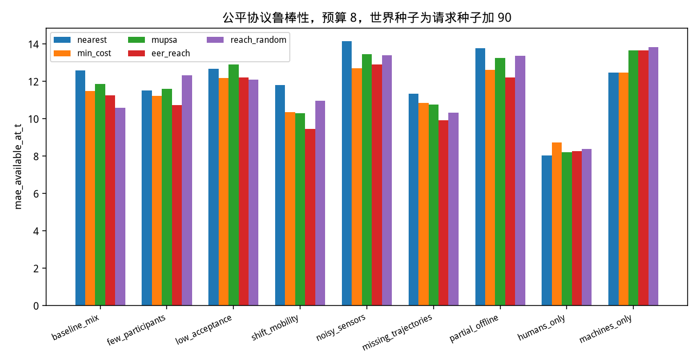

baseline_mix 上 reach_random 的平均 MAE 低于 eer_reach。few_participants 上 eer_reach 低于 reach_random，说明“随机地在可达格里选”并不总是差，也不总是好。humans_only 上 nearest 有 2.67 次成功，MAE 8.031，低于 eer_reach 的 8.265。只有人、而且人真的能走到近处时，当前距离这个弱基线可以赢。

machines_only 上 nearest 和 min_cost 的成功次数都是 0，MAE 12.463。mupsa、eer_reach 和 reach_random 各成功 4 次，MAE 却是 13.663、13.678 和 13.841。在这个变体里，把机器派去采样增大了误差。传感器噪声和错误的格子选择都会把观测变成负面影响。这是人机混合假设没有得到支持的一个具体格子：机器不是自动的精度来源。

low_acceptance 把接受概率降到 0.3。nearest 成功 0 次。eer_reach 仍有 3.67 次成功，但 MAE 12.217，只略低于 nearest 的 12.675，差距小于标准差。noisy_sensors 把 σ 提到 4.0，所有方法的 MAE 和标准差都变大，eer_reach 12.908±4.269，不能从这 3 个种子里读出稳定优势。

## 9.9 运行时间

`scripts/time_episodes.py` 在一个共享的 8×8 regular 世界上，预热一次后每种方法重复 5 次。结果在 `timing.json`。平均墙钟大约 7.6 到 11.0 毫秒。bandit 是 11.0 毫秒，其余方法在 7.6 到 9.0 毫秒。图 9-9 是这组毫秒数。

这个时间只说明小网格上的 Python 实现没有数量级差异。它不是 200×200 的 YJMob 全图，也不是 2900 万法国点的 IDW。全图实验没有跑，所以没有全图时间。

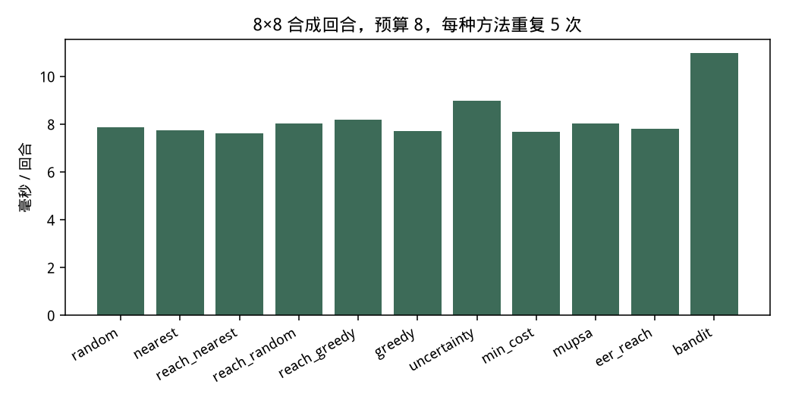

## 9.10 旧协议图

`experiments/figures/main/robustness_mupsa.png` 属于第一阶段。那时回合种子包含预算和方法名，不同方法看到的世界不同。本报告不把那张图放进正文，也不把它的曲线和第 9.8 节比较。文件仍留在仓库里，避免覆盖历史结果。

## 9.11 本章结论

合成 regular、n=3、8×8 上，eer_reach 的平均 MAE 在三个预算里都是所列方法的最低值。合成 complex 上，预算 4 和 12 的最低值是 reach_random。真实轨迹的四个窗口上，eer_reach 都不是最低，而且多次比成功次数更少的方法更差。噪声留出的 R² 为负。鲁棒性里，只有机器的时候，成功采样增大了误差。

这些句子都能在 JSON 里逐格核对。它们不支持“MU-PSA 或 EER 在所有预算和所有数据上获胜”。

# 第 10 章 系统测试与质量验证

## 10.1 本次执行

2026-11-10，在本机执行：

```
PYTHONPATH=src .venv/bin/python -m pytest -q --tb=no
```

结果：21 passed，1 warning，4.15 秒。警告是 Starlette 提示 `httpx` 与 `TestClient` 的搭配将过时，不是失败。测试模块是 `tests/test_api.py`、`tests/test_algorithms.py`、`tests/test_phase2.py`。

phase2 测试覆盖共享环境哈希、预算和方法名不再进入环境种子、fully_real 在缺少重叠清单时不可用，以及 YJMob 坐标不会被写成经纬度。算法测试覆盖状态机非法边、IDW 的能量域和分配分数的基本不变量。API 测试用 TestClient 作为上下文管理器，这样启动时会建表。

## 10.2 没有在本次重跑的测试

浏览器脚本 `scripts/shoot_phase2.mjs` 在更早的一轮已经对活动的 API 跑过，退出码当时为 0，并写出第 7 章使用的 round1 截图。本次写报告时没有再次启动浏览器。因此“截图与当前工作区代码一致”依赖这些文件已经在同一分支上，而不是依赖一次新的点击。

Windows 脚本在本 Linux 环境没有执行。`scripts/setup_windows.ps1`、`start_windows.ps1`、`test_windows.ps1` 和 `stop_windows.ps1` 只经过阅读，没有在 Windows 11 上跑通。第 11 章把它们写成操作说明，不写成已通过的测试。

`cursor/phase2-tests-63b5` 上曾有 41 passed 和 2 个 xfail。那两个 xfail 记录的是旧代码：bandit 仍分配到达概率为 0 的配对，以及旧的按方法扰动种子。那些测试不在当前分支的 21 个通过数里。本报告不把 41 加到 21 上。

前端 `npm run build` 在阶段二曾成功。本次没有改前端，也没有重跑 build。

## 10.3 数据泄漏

决策函数 `decision_context` 的观测子集截止在 `visible_until`，轨迹当前位置也取自该时点。真值数组 `world.laeq` 在 `step_campaign` 里于到达且接受之后才被读取，用来生成测量；在回合结束后被读取，用来计算 MAE。公平协议的说明文本写在 `summary.json` 的 `protocol.text`。

仍然存在的泄漏风险是参数本身。合成场的生成规则、传感器 σ 和接受概率是场景已知常数。模型没有从评估期“学习”它们，但实验设计者知道它们。这不是训练测试混用，只是仿真没有隐藏的传感器偏差。

NoiseCapture 留出按时间分位切开，训练段和测试段不是同一些小时箱。它没有按空间阻挡，所以相邻格子可以一边在训练、一边在测试。空间自相关会让这个 MAE 偏乐观。即便如此 R² 仍是负的，乐观偏差没有把它救成正值。

## 10.4 正确性与失败

状态机测试拒绝非法边和错误角色。系统角色被允许核验，这是为了仿真，测试必须把这条写成允许，而不是把 409 当成缺陷。

已知且未在本分支用新测试关掉的问题：LinUCB 的乐观项可能盖过极低的到达概率。第 9 章 bandit 的到达概率约 0.15、成功次数停在 1，与这个缺陷相容，但主表本身不是该缺陷的单元测试。

端口方面，启动脚本若发现 8000 已被占用会失败。应用的环境变量 `UNLAB_API_PORT` 和 `UNLAB_WEB_PORT` 可以改端口。停止脚本只结束自己写下的 pid，避免误杀别人的进程。

# 第 11 章 部署、运行与复现

不使用 Docker。下面的命令是仓库脚本的入口。Windows 段没有在本次环境执行。

## 11.1 Linux

```
cd GraduateProject
python3 -m venv .venv
source .venv/bin/activate
pip install -r requirements.txt
cd apps/web && npm install && cd ../..
# 可选：下载数据。压缩包很大，不会被 Git 跟踪。
python scripts/download_datasets.py --help
PYTHONPATH=src python -m pytest -q
# 启动。若 8000 被占用：
UNLAB_API_PORT=8010 UNLAB_WEB_PORT=5175 bash scripts/start_linux.sh
```

停止使用 `scripts/stop_linux.sh`。健康检查是 `GET /api/health`。前端开发地址由 Vite 打印，API 前缀是 `/api`。

数据目录由 `UNLAB_DATA_DIR` 指定，默认是仓库里的 `data/`。数据库是 `UNLAB_DATABASE_URL`，默认 SQLite 文件。JWT 密钥是 `UNLAB_JWT_SECRET`。

切换数据源在仿真页的下拉框，或调用场景接口。real_mobility 需要已经预处理的轨迹。fully_real 在清单不声明时间和地理重叠时返回 409，这是预期，不是端口错误。

公平主实验：

```
PYTHONPATH=src python scripts/run_phase2_episodes.py
```

该命令会重写 `experiments/results/phase2/fair_main`。重写前应保留现有 JSON，否则本报告的表将无法逐字对上。鲁棒性和耗时是两条独立命令：

```
PYTHONPATH=src python scripts/run_robust_fair.py
PYTHONPATH=src python scripts/time_episodes.py
```

报告图：

```
PYTHONPATH=src python scripts/build_report_assets.py
python scripts/render_report.py \
  docs/final-report/UrbanNoiseLab_完整系统报告.md \
  docs/final-report/UrbanNoiseLab_完整系统报告.pdf
```

PDF 使用本机文泉驿微米黑 `/usr/share/fonts/truetype/wqy/wqy-microhei.ttc`。没有这套字体时，中文会变成方框，应停止发布而不是换一个不含中文的 PDF。

## 11.2 Windows PowerShell

在仓库根目录：

```
py -3 -m venv .venv
.\.venv\Scripts\Activate.ps1
pip install -r requirements.txt
cd apps\web
npm install
cd ..\..
$env:PYTHONPATH = "src"
python -m pytest -q
$env:UNLAB_API_PORT = "8010"
$env:UNLAB_WEB_PORT = "5175"
powershell -ExecutionPolicy Bypass -File .\scripts\start_windows.ps1
```

停止使用 `scripts/stop_windows.ps1`。路径分隔符和虚拟环境的 Activate 脚本与 Linux 不同，算法命令相同。本次没有在 Windows 上验证执行策略、端口和浏览器。若 PowerShell 拒绝脚本，需要由使用者在自己的机器上处理执行策略，而不是把 Docker 加回来当作替代。

## 11.3 数据与结果怎么看

下载清单：`docs/data/full_archive/dataset_download_report.md`。

质量计数：`docs/data/full_archive/dataset_quality_report.md`。

公平主表：`experiments/results/phase2/fair_main/summary.json`。

真实轨迹和噪声留出：`experiments/results/phase2/real_runs.json`。

鲁棒性：`experiments/results/phase2/robust_fair/results.json`。

耗时：`experiments/results/phase2/timing.json`。

原始 parquet 和 zip 不在 Git 中。换一台机器只克隆仓库，可以阅读结果和报告，不能重画第 5 章的热力图，除非重新下载并预处理。

## 11.4 演示账号

管理员、发布者和采集者的演示按钮写在登录页。口令随种子数据发布，页面声明不能用于生产。本报告故意不把口令再抄一遍到公开段落之外的“默认配置建议”里。部署说明若必须包含演示口令，应同时包含更换步骤。

# 第 12 章 研究贡献、局限与总结

## 12.1 已经实现的工程功能

可登录的三种角色和系统角色，任务状态机，合成世界，YJMob 与 GeoLife 轨迹进入仿真且不改写未来格子，NoiseCapture 小时箱的时间留出，地图上区分虚拟网格和 WGS84，fully_real 在条件不满足时失败，公平环境种子，Linux 启动脚本，以及一份由结果文件生成的中文报告。

## 12.2 已经验证的算法效果

在第 9.2 节的合成 regular 设置下，eer_reach 的三种子平均 MAE 低于所列出的其他方法。到达约束的消融若被去掉，成功次数变为 0。这些是支持性的、范围很窄的结果。

## 12.3 候选创新，以及它们还不是结论

候选点是：把到达概率、接受概率和一步方差下降放进同一次分配，并且在执行时用真实存储的未来格子而不是用概率采样来判定到达。文献里的传感器放置假定传感器会被装上，轨迹招募论文往往假定轨迹已知。这个组合是工程上的候选，不是已证明的新理论。

实验没有支持“该组合在真实轨迹上降低噪声地图误差”。四个真实移动窗口都有更简单的方法取得更低的 MAE。机器单独采样时，成功测量增大了误差。高不确定度不等于期望地图误差，这个假设在本数据上仍然只是假设，而且已有反例。

## 12.4 没有得到支持的说法

MU-PSA 不是所有预算的最优。eer_reach 不是所有场景的最优。LinUCB 没有在两轮训练后表现出可用的分配。负 R² 不是“模型可用，只是还有改进空间”，而是这次 IDW 比均值更差。Fully-Real 没有做。Windows 没有在本环境跑过。优秀毕业论文的评价不属于本报告。

## 12.5 数据限制

YJMob 是匿名网格。GeoLife 含非法纬度和大量被拒绝的跳跃。NoiseCapture 的 lden 全为 0，点测量含有物理上异常的分贝。三个数据集在城市噪声这个对象上并不闭合：移动数据没有噪声，噪声数据没有这些移动者。合成噪声填上了实验，也限制了解释。

## 12.6 尚未完成

空间协方差下的真正期望误差下降。用真实接受和拒绝记录估计接受概率。把 2009-02-14 的 32 人 GeoLife 窗口和更多 YJMob 用户放进同一协议。对法国原始点做清洗后再预测，而不是只抽 4000 个小时箱。校准不确定度。修复并测试 LinUCB 的零到达分配。在 Windows 11 上执行启动脚本。用配对检验和更多种子重估第 9 章里小于标准差的差距。CDRI 的 `paper confirm` 仍未运行。

## 12.7 总结

系统把“人会不会到”和“测了有没有用”分开记账，并且把账记在可重复的文件里。账上的结果是：在一小块合成网格的 regular 场景，一步方差下降配合到达约束，平均误差较低；一旦换成真实脚印或另一张合成场景，更简单的规则经常更好；真实手机噪声上，当前 IDW 不如均值。后续论文可以引用这些失败，但不可以把系统完成写成算法已经成立。

# 参考文献与阅读深度

下列 DOI 均出现在 `docs/research/literature_review.md`。阅读深度沿用该笔记，没有在写报告时升级。

1. Krause, Singh, Guestrin. Near-Optimal Sensor Placements in Gaussian Processes: Theory, Efficient Algorithms and Empirical Studies. JMLR, 2008. DOI 10.5555/1390681.1390689. 出版 PDF 的方法与结论。
2. Guestrin, Krause, Singh. Near-optimal sensor placements in Gaussian processes. ICML, 2005. DOI 10.1145/1102351.1102385. 仅摘要。
3. Singh, Krause, Guestrin, Kaiser. Efficient Informative Sensing using Multiple Robots. JAIR, 2009. DOI 10.1613/jair.2674. 第 1–2 节，未摘实验曲线。
4. Cao, Low, Dolan. Multi-robot informative path planning. AAMAS, 2013. 阅读文本为 arXiv:1302.0723。
5. Yabe et al. YJMob100K. Scientific Data, 2024. DOI 10.1038/s41597-024-03237-9. 数据描述，行数以本仓库解析为准。
6. Zheng, Zhang, Xie, Ma. Mining interesting locations and travel sequences from GPS trajectories. WWW, 2009. DOI 10.1145/1526709.1526816. 题名已核实。
7. Song, Qu, Blumm, Barabási. Limits of Predictability in Human Mobility. Science, 2010. DOI 10.1126/science.1177170. 题名已核实，未引用未复核的百分比。
8. Picaut et al. Building and Environment, 2019. DOI 10.1016/j.buildenv.2018.10.049. 题名与 DOI，未读测量协议全文。
9. Wang et al. Sparse mobile crowdsensing. IEEE Communications Magazine, 2016. DOI 10.1109/MCOM.2016.7509395. 仅摘要。
10. Zhao et al. IEEE Open Journal of the Computer Society, 2022. DOI 10.1109/OJCS.2022.3177290. 仅摘要。
11. Wang et al. 格子选择. ICDCS, 2018. DOI 10.1109/icdcs.2018.00164. 阅读文本为 arXiv:1804.07047 的引言，Q 公式未逐式核对。
12. Liu et al. Computer Networks, 2019. DOI 10.1016/j.comnet.2019.06.010. HAL 作者稿结论，不是出版商 PDF。
13. Zhang et al. Mathematical Biosciences and Engineering, 2023. DOI 10.3934/mbe.2023533. 摘要与第 6 节，STGCN 公式未逐式核对。
14. Mussmann et al. arXiv:2211.09283. 预印本方法节。
15. Alexanderian. Inverse Problems, 2021. DOI 10.1088/1361-6420/abe10c. 阅读文本为 arXiv:2005.12998 第 1 节。
16. Ao, Li. AAAI, 2024. DOI 10.1609/aaai.v38i18.30012. 摘要与引言。
17. Wu, Liang, Yang. arXiv:2604.21849. 预印本第 1 节。
18. Nishida et al. IEEE TSP, 2022. DOI 10.1109/tsp.2022.3156012. PDF 第 1 页。
19. Verburg et al. EURASIP Journal on Audio, Speech, and Music Processing, 2024. DOI 10.1186/s13636-024-00364-4. 摘要、引言和问题开头。
20. Huang et al. MBBALD, 2026. DOI 10.1007/s42486-025-00202-2. 摘要、引言和第 4.1 节。
21. Li et al. IEEE/ACM Transactions on Networking, 2022. DOI 10.1109/tnet.2022.3169180. 阅读文本为 arXiv:2107.01385 第 1–2 节。
22. Simon et al. IEEE TCOM, 2024. DOI 10.1109/tcomm.2024.3381718. 仅摘要。
23. Liu et al. IEEE Access, 2019. DOI 10.1109/access.2019.2924184. 仅 PDF 摘要。
24. Zhu et al. IEEE Internet of Things Journal. DOI 10.1109/jiot.2020.3024833. 仅仓库摘要。
25. Ganti, Ye, Lei. IEEE Communications Magazine, 2011. DOI 10.1109/MCOM.2011.6069707. 题名与 DOI。
26. Capponi et al. IEEE COMST, 2019. DOI 10.1109/COMST.2019.2914030. 摘要级。

撤回且不引用为方法的记录：DOI 10.21203/rs.3.rs-4954416/v2。
