# 人机混合城市噪音预测采样与智能任务分配系统：系统设计、算法实现与实验验证报告

> 历史版本。这是第一阶段报告，不是最终入口。最终报告是 `docs/final-report/UrbanNoiseLab_完整系统报告.md`。

UrbanNoiseLab 是一套可运行的毕业设计系统。它把虚拟城市里的人与机器轨迹、噪声预测和预算约束放进同一次任务分配，并用真实接口把任务从草稿推进到完成。本报告只写已经在仓库里运行过的部分。内部方法名 MU-PSA 表示 Mobility- and Uncertainty-Aware Predictive Sampling and Assignment，不表示已经证明的学术创新。

## 第一章 项目背景与研究目标

城市噪声监测若只靠固定站点，覆盖和成本都受部署位置限制。移动群智感知让携带麦克风的人和车载或手持设备参加采集。Ganti、Ye 与 Lei 2011 年的综述以及 Capponi 等人 2019 年的综述已经把这个范式写清楚。稀疏群智感知进一步承认不能在每个格子、每个时刻都采样，未采样位置要靠相关结构推断。Wang 等人 2016 年的文章和 Zhao 等人 2022 年的综述都把“选哪些点”和“如何补全”列为核心困难。这些文献的题名和 DOI 已在 `docs/research/references.bib` 中按 Crossref 或 OpenAlex 记录。本次没有做全文精读，摘要级转述见 `docs/research/literature_review.md`。

本项目要回答的工程问题是：预算有限、人在移动、机器只会巡逻时，下一时间片测哪里、交给谁，才能在不偷看未采样真值的前提下改变噪声图的误差和覆盖。问题拆成三步，但必须接成闭环。人下一时刻可能出现在哪里，只给出到达概率。噪声场哪里不确定，只根据已经拿到的观测。谁来执行，还要乘上接受概率和设备质量，并减去成本。经过某格子不等于愿意接任务。

系统目标是一个能登录、发任务、分配、采样、回写和再规划的测站，外加可复现实验。功能范围包括三类角色、虚拟网格地图、合成噪声场、三种以上分配基线、LinUCB 短名单策略，以及 YJMob、GeoLife、NoiseCapture 的格式适配器。完整外部数据包没有下载，所以没有全真实数据实验。

## 第二章 需求分析

管理员维护用户、设备和数据源，并能打开仅用于评估的真值层。任务发布者创建采样任务、选择算法、推进仿真并核验结果。采集参与者只能处理分配给自己的任务。演示账号和权限见 `docs/requirements/requirements.md`。

任务状态从 draft 到 published、assigned、accepted、in_progress、submitted、verified、completed。旁边还有 rejected、expired、failed、cancelled、reassigned。合法迁移和角色写在 `src/urbannoise/domain.py`。采集者提交必须带测量值。过期只有在当前时间片晚于窗口终点时才允许。仿真器完成自动核验时使用 `system` 角色，因此 `submitted → verified` 对 system 开放。采集者自己不能核验。

典型过程：发布者创建草稿并发布，调用分配，仿真时钟推进一步，到期任务按真实轨迹决定成败，成功观测写入数据库，预测在下一轮看到这些观测。页面按钮调用上述接口。浏览器脚本实际创建了一条标题带时间戳的任务并把它发布，也执行了分配和单步。

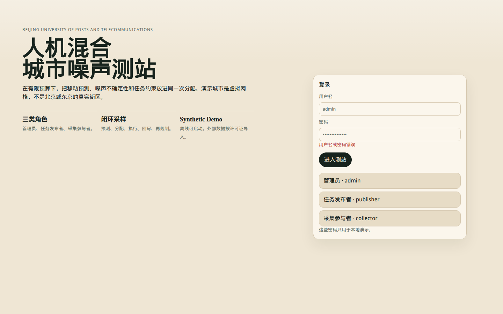

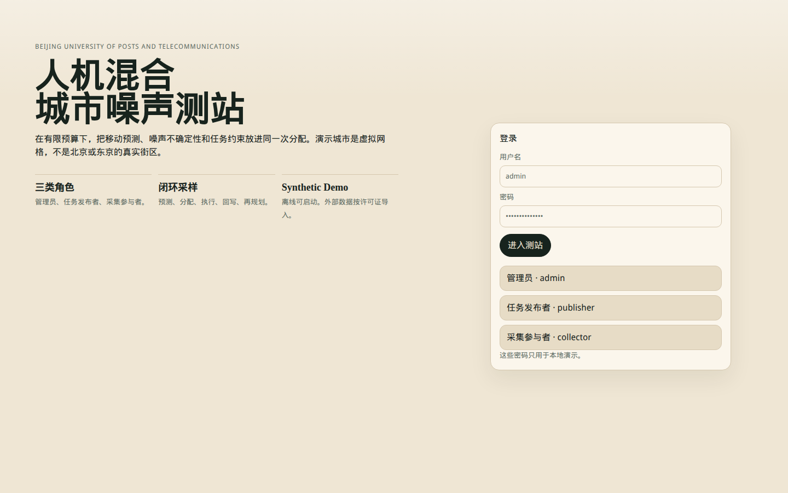

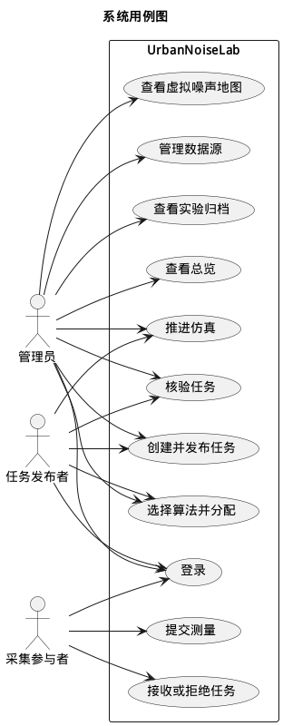

## 第三章 系统总体设计

前端是 Vite、React 与 TypeScript。后端是 FastAPI。算法使用 NumPy、scikit-learn 和 SciPy。默认数据库是 SQLite。选择 SQLite 是因为这台机器没有 PostgreSQL 服务，演示数据量也放得进一个文件。PostGIS 没有使用，因为演示网格没有经纬度。Redis 没有使用，实验用进程内线程。

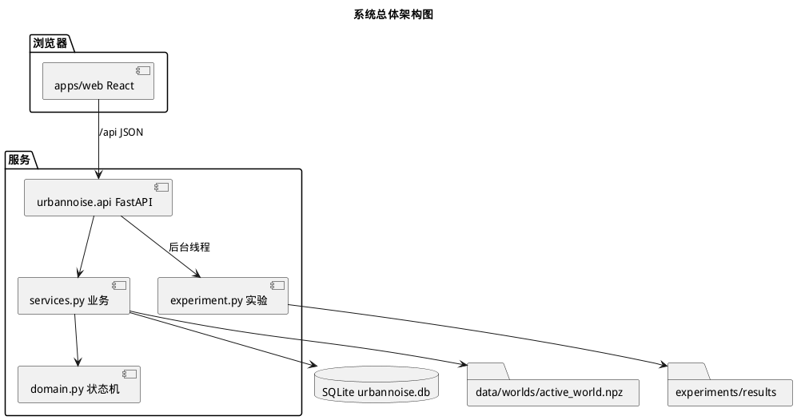

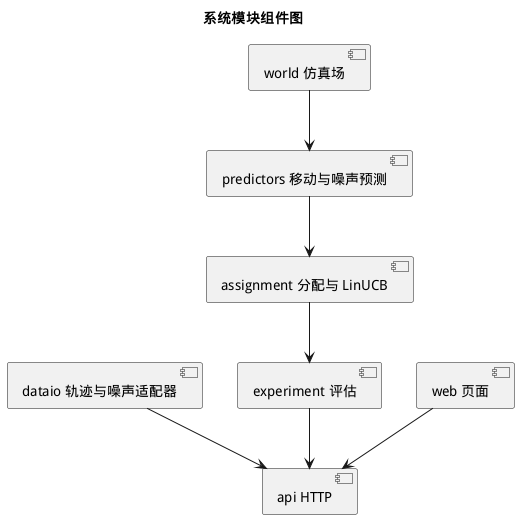

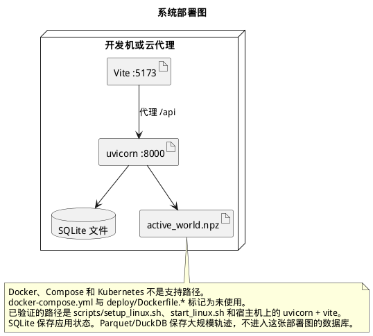

交互方式是 REST 和 JSON。OpenAPI 由 FastAPI 自动生成在 `/docs`。耗时的实验配置在请求提交之后放到守护线程，避免把整段 main 实验堵在一次 HTTP 连接里。

## 第四章 数据集设计与处理

### 合成演示数据

系统可以在不下载外部数据时启动。演示轨迹和噪声标记为 Synthetic Demo，坐标系统是 `synthetic_virtual_grid`，`real_city` 为假。默认世界 16×16，两天，每天 48 个时间片，14 名人类和 4 台机器，场景 complex，种子 7。主实验为了缩短时间使用每天 24 个时间片，不能把演示时钟说成 YJMob 的 30 分钟原始数据。

噪声在能量域生成。用地基线大约是居住 46 dB、商业 60 dB、道路 70 dB、工业 74 dB、公园 38 dB、学校 52 dB，再乘日变化、周变化、空间平滑和对数正态扰动。复杂场景加入局部能量突发。偏移场景在第二天把一块居住区提高 8 dB、商业区降低 4 dB，并让一部分人在 16 点后回家。传感器噪声只在采样时以分贝加法加上，不进入预测器的输入。

人类轨迹按家、工作和通勤时段生成，并有抖动和缺失。机器在每天同一日内时间回到同一巡逻格。这些都是合成规则，不是从 YJMob 估计出来的。

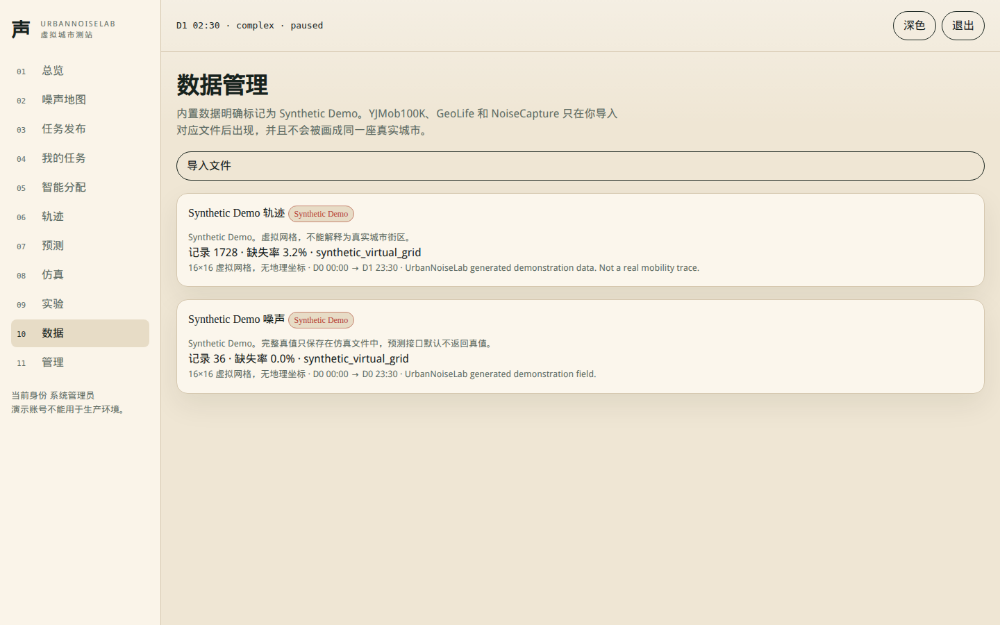

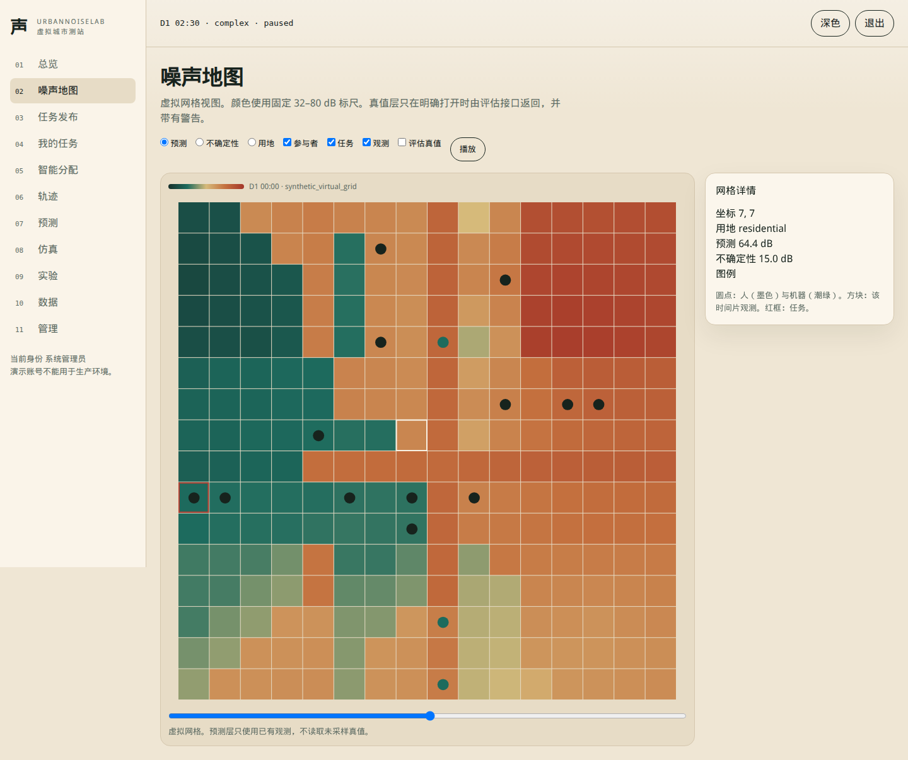

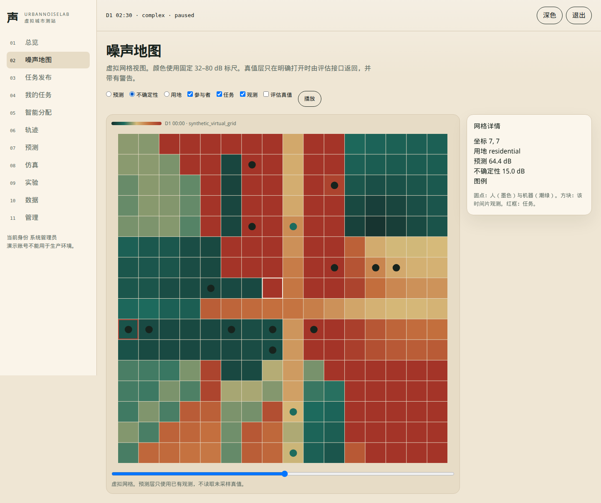

### 外部数据

YJMob100K 论文已核实：Yabe 等人，*Scientific Data*，2024，DOI `10.1038/s41597-024-03237-9`。适配器读取 csv 中的用户、日、时间片和 x、y，坐标系统写成 `yjmob_virtual_500m`。完整压缩包没有下载，因此本报告不把未重新计数的记录规模写成已复核事实。虚拟网格不会标成北京或东京街区。

GeoLife 适配器读取 Microsoft `.plt`：跳过 6 行表头，保留 WGS84。Zheng 等人 2009 年 WWW 论文 DOI `10.1145/1526709.1526816` 已核实。完整轨迹没有下载。

NoiseCapture 方向的论文题名已核实为 Picaut 等人 2019 年 *An open-science crowdsourcing approach for producing community noise maps using smartphones*，DOI `10.1016/j.buildenv.2018.10.049`。导入器接受 GeoJSON 点，并按字段名保留不同分贝指标。不同指标不会自动合并。导入点不写入演示网格编号。

声能平均是 `10*log10(mean(10^(L/10)))`。40 dB 与 60 dB 的声能平均约为 57.03 dB，不是 50 dB。算术平均另有函数，二者不混用。

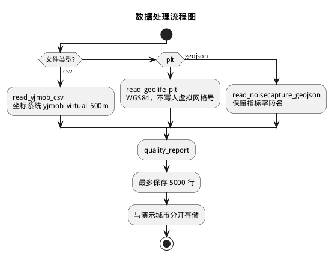

## 第五章 算法设计

符号与代码一致，写在 `docs/algorithms/mupsa.md`。这里给出决策时实际使用的量。

时刻 t 的移动分布只由 `0..t` 的位置估计。到达概率是 0.55 的日内时段频率加 0.45 的 lead 步马尔可夫滚动。接受概率是参与者属性。执行成功还要求目标时刻的真实轨迹等于任务网格。

噪声预测默认是能量域反距离加权。距离包含空间距离、日内循环时间差和用地不一致惩罚。不确定性随邻居分歧和最近距离增大，并截断到 15 dB。随机森林和固定核高斯过程是对照。样本太少或太多时高斯过程退回 IDW。

采样价值是归一化不确定性、覆盖缺口、隔离程度、时间缺口之和，减去重复采样惩罚。MU-PSA 用到达概率、接受概率和质量乘上这个价值，再减去 0.35 倍成本。它不是互信息，也没有 (1−1/e) 保证。Krause、Singh 与 Guestrin 2008 年的传感器放置论文讨论的是高斯过程与次优保证，本实现没有继承该保证。

约束是：每个参与者在目标时间片最多一个任务，同一格子不重复分配，成本不能超过剩余预算。失败的仿真任务可以退款。已完成任务不能再次按普通提交进入。

LinUCB 的动作是最多 20 个候选配对，上下文 10 维，不含真值。训练奖励可以使用仿真误差的下降，这一点必须和“推理不看真值”分开说。没有实现 PPO。

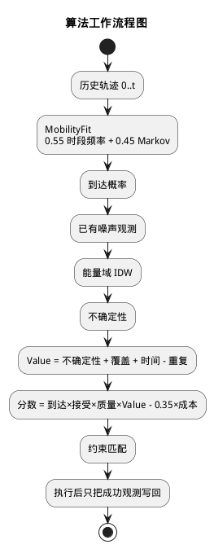

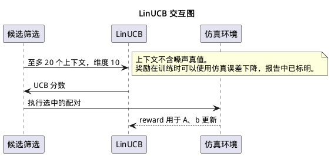

主实验使用的移动预测，在该次探测的 461 个事件上：Top-1 0.761，Top-3 0.855，NLL 4.121，Brier 0.378。这是合成轨迹上的数字，不能外推到 YJMob100K。

噪声模型在同一次 70/30 观测留出上：IDW 的 MAE 12.573、RMSE 15.400、区间覆盖 0.905、平均宽度 40.17；随机森林 MAE 7.985、覆盖 0.810、宽度 29.26；高斯过程 MAE 8.678、覆盖 1.0、宽度 58.40。宽度 58 dB 的区间覆盖率没有解释价值。用历史观测在一个历史时间片上重建全场时，IDW 的 MAE 是 7.683。R² 用误差方差计算，所以可能和 MAE 的排序不一致。

## 第六章 系统详细设计与实现

数据库表包括 users、participants、devices、mobility_datasets、trajectory_points、noise_datasets、noise_observations、spatial_grids、sensing_tasks、task_assignments、assignment_events、sampling_results、simulation_runs、experiment_runs、evaluation_metrics、audit_logs。主键和外键由 SQLAlchemy 声明。SQLite 打开外键。没有空间索引，因为虚拟网格用整数坐标。

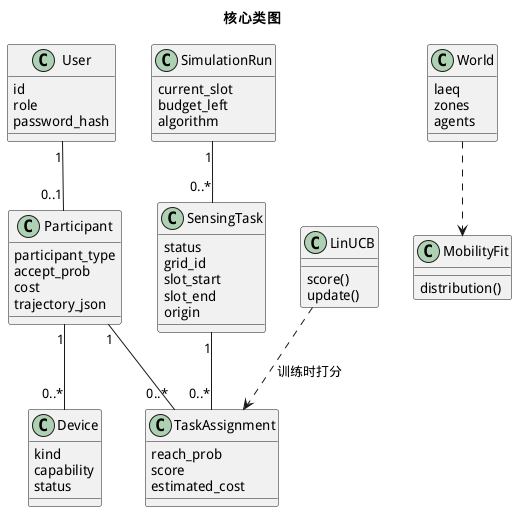

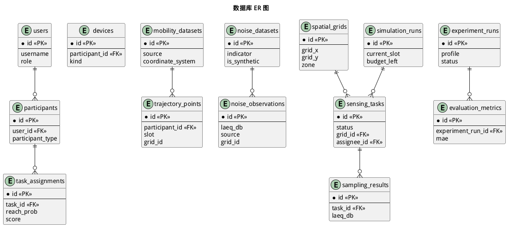

身份认证是用户名和 PBKDF2 口令，成功后签发 JWT。演示用户在空库启动时写入。

任务发布调用 `POST /api/tasks`，得到 draft。发布按钮调用迁移接口。浏览器测试里新建任务从 draft 变成 published。

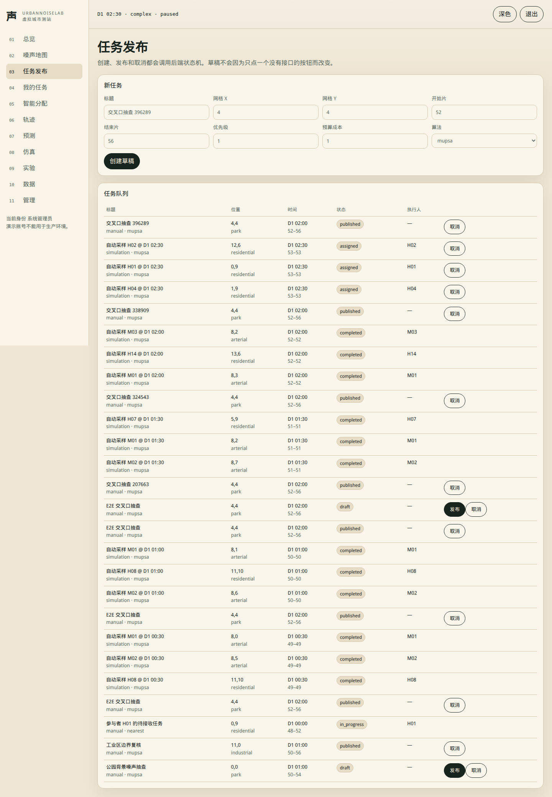

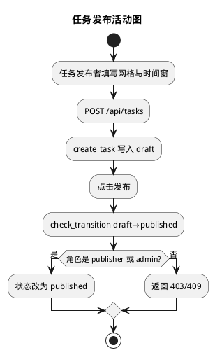

分配接口按当前时钟加 lead 规划，写入仿真来源任务并预扣预算。下图是一次真实点击之后的记录，到达概率和成本来自计算，不是写死的表格。

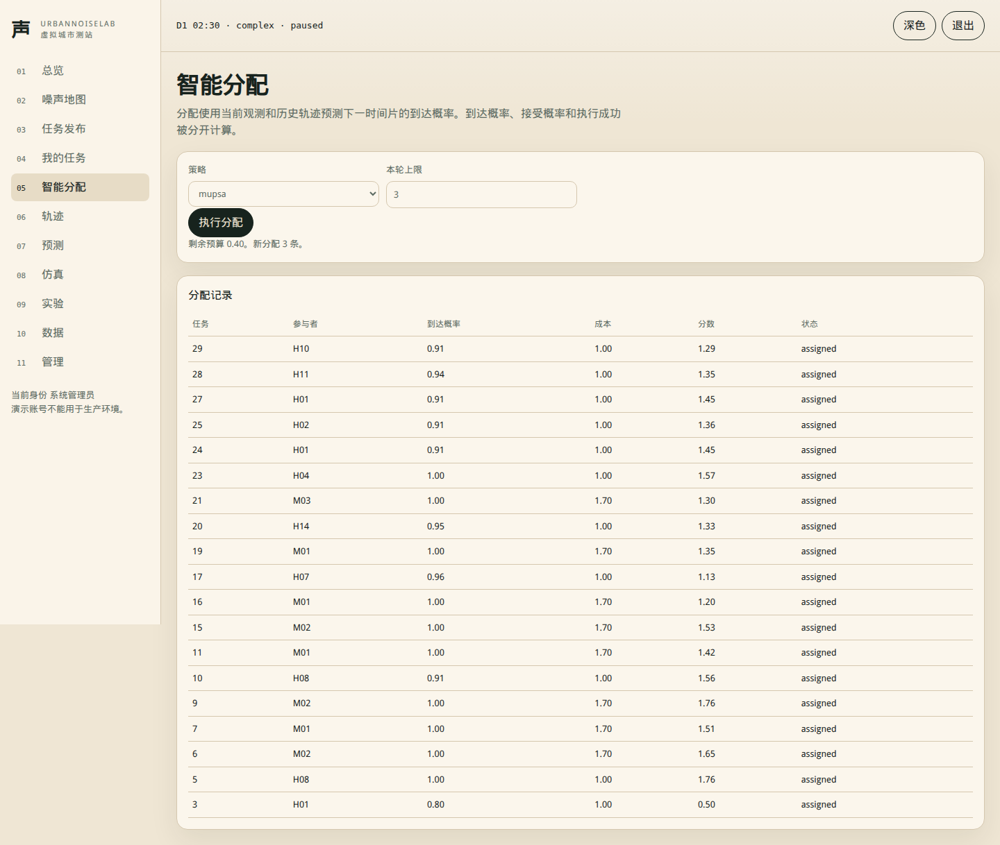

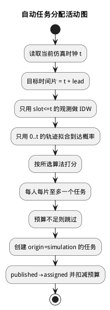

仿真单步只执行属于当前仿真轮、且时间片已到的任务。成功时读取该格真值并加噪声，状态走到 completed。日志里出现“时钟推进到”和分贝读数。

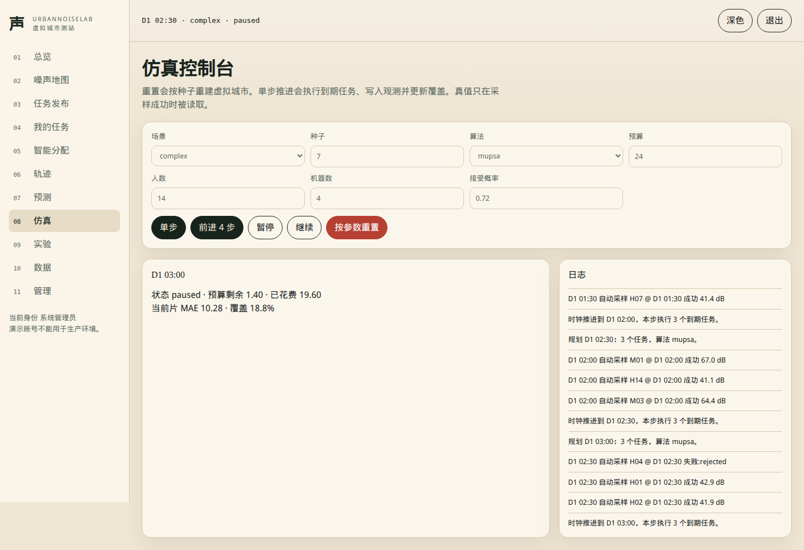

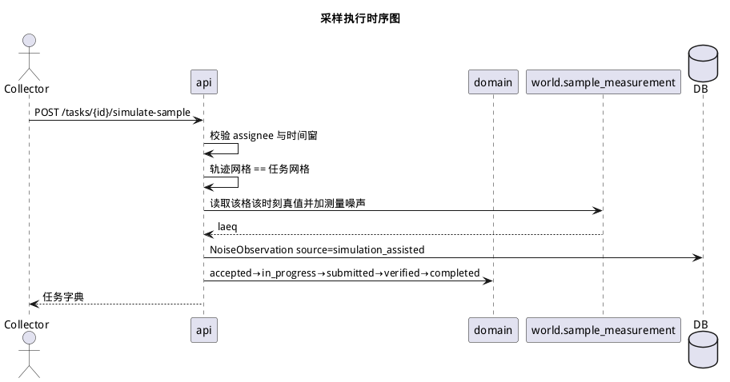

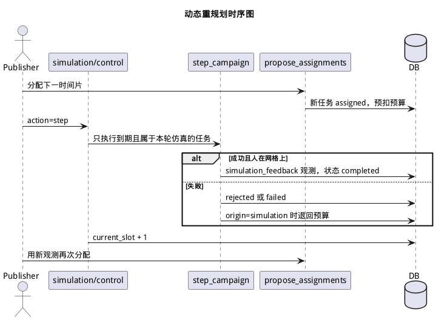

采集者页面只列出自己的任务。接收、开始和仿真采样都是接口。仿真采样若当前轨迹不在任务格，后端拒绝，避免从不存在的位置读真值。手工提交则把用户填写的分贝记为 `manual`。

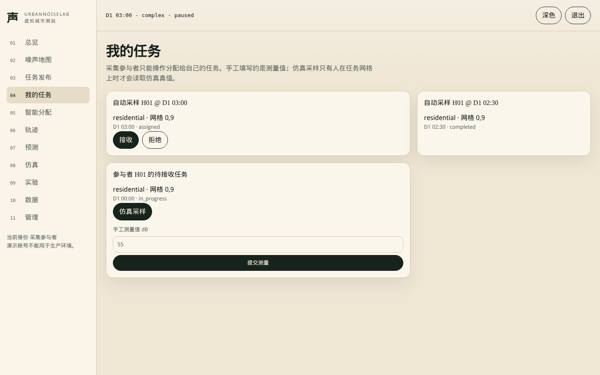

轨迹页显示合成轨迹的热点和下一位置概率，并写明到达概率不是接受概率。

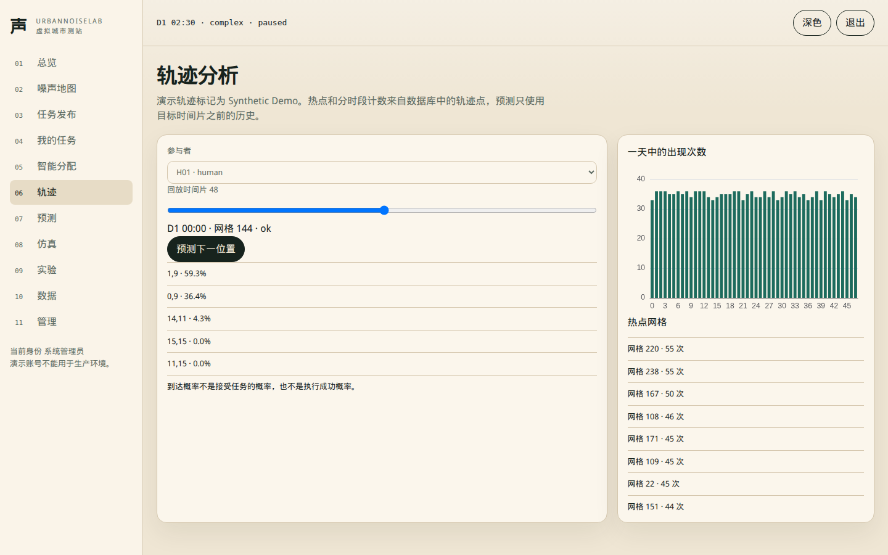

预测页可切换 IDW、随机森林和固定核高斯过程。页面声明不确定性未经独立校准。

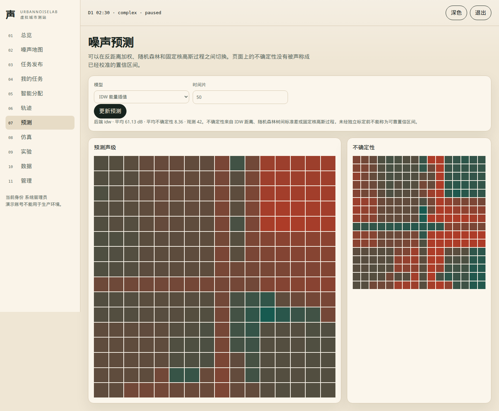

总览的曲线是各时间片观测的声能平均。活跃任务、预算和覆盖率来自数据库。

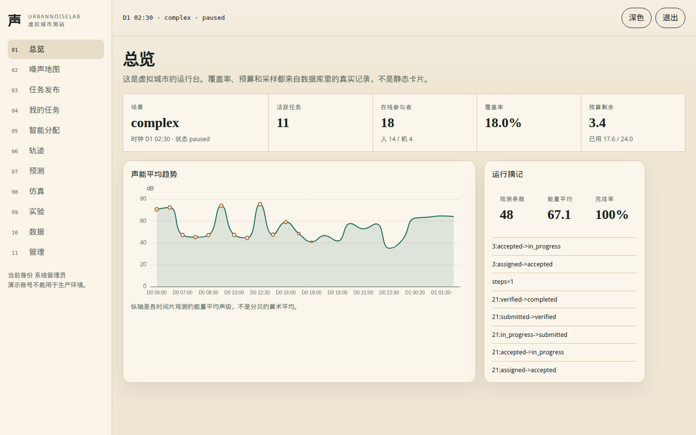

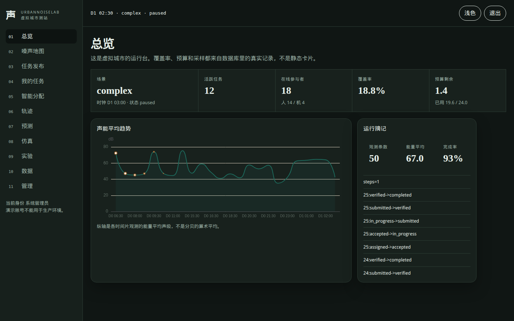

实验页读取 `experiments/results/main/summary.json` 画因果 MAE。按钮“运行 smoke”会启动真实进程。

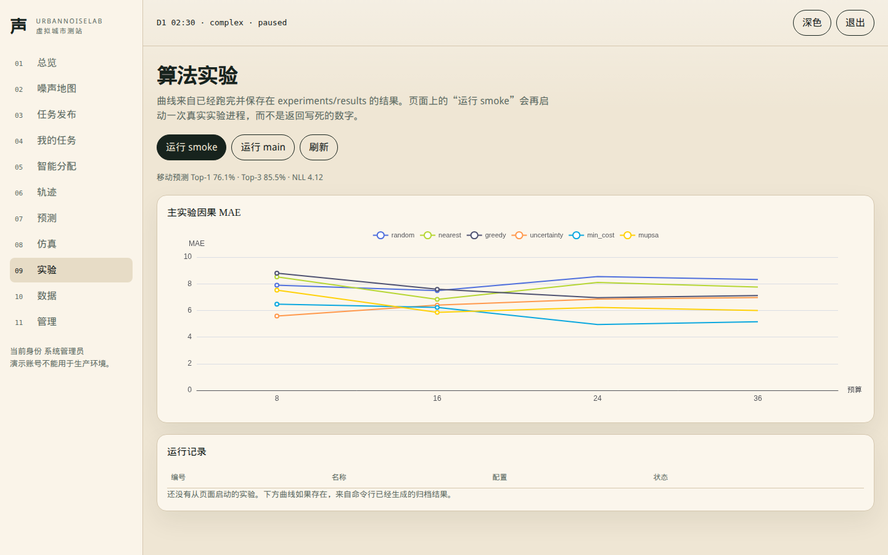

管理页可以创建用户、切换参与者在线并查看审计。

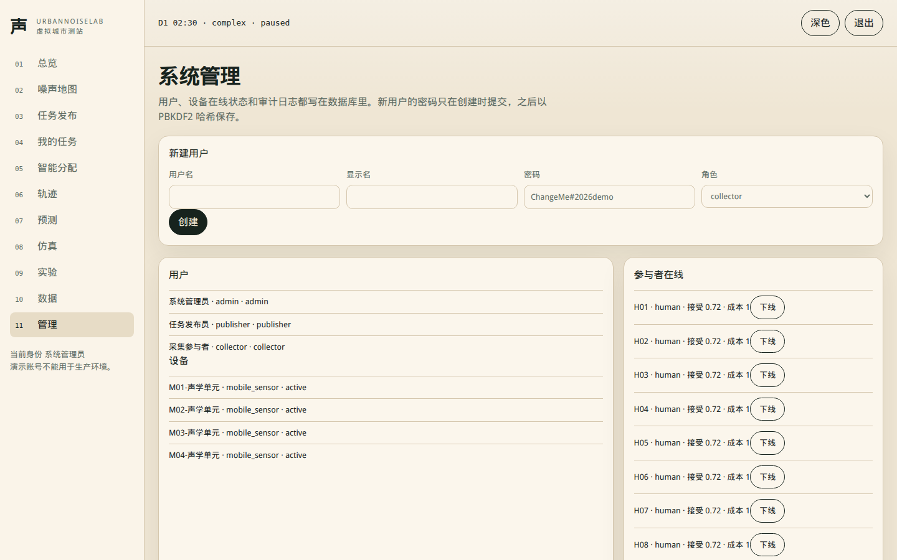

## 第七章 系统界面

视觉方向是纸色和潮绿色的测站，而不是通用紫色后台。字体优先使用文泉驿微米黑。设计变量在 `apps/web/src/index.css`。深色主题通过 `data-theme` 切换。

信息架构是左侧 11 个入口：总览、噪声地图、任务发布、我的任务、智能分配、轨迹、预测、仿真、实验、数据、管理。地图使用画布绘制虚拟网格，不用真实底图冒充配准。

`npx skills add` 没有在本次形成安装记录。界面经过两轮浏览器截图：第一轮发现登录留白、实验图例挤在坐标轴上、移动端导航把汉字拆开、总览曲线在窄屏上没有撑开。第二轮改为顶对齐的登录说明、图例放在图上方、导航不换行并可横向滚动，并用 ResizeObserver 重绘图表。

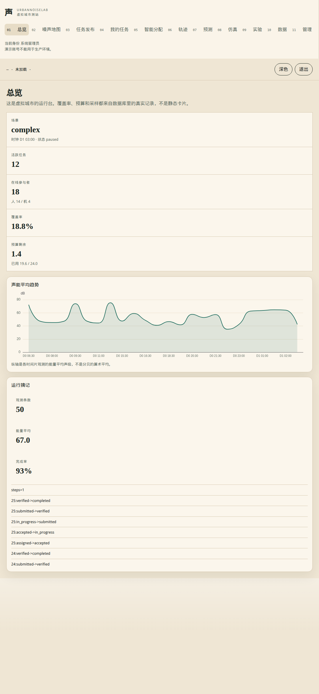

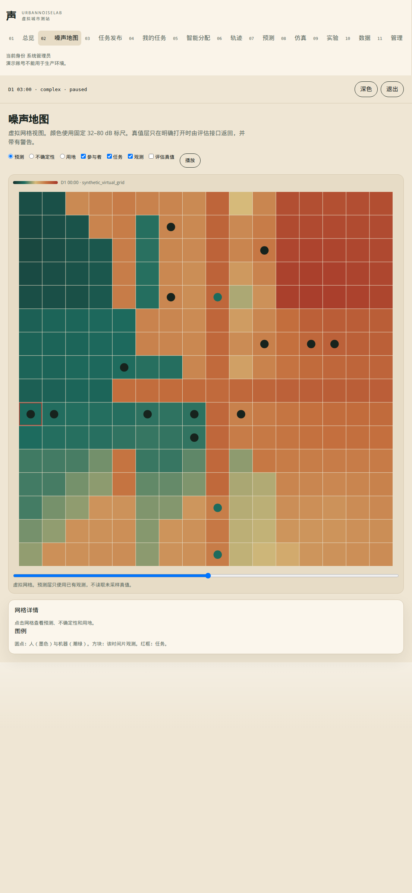


## 第八章 算法实验与结果分析

### 环境与协议

主结果来自 `experiments/results/main/summary.json`，图在 `experiments/figures/main`。配置是 `experiments/configs/main.json`：14×14 网格，每天 24 片，两天，16 名人类和 4 台机器，预算 8、16、24、36，种子 0 到 4，场景 regular 与 complex。先验观测来自评估期之前。因果 MAE 在每个评估时间片只用当时及更早的观测，对干净场求平均绝对误差。五种主方法加不确定性采样使用同一函数。MU-PSA 不能读未来轨迹或未采样真值。测试里检查了这件事。

机器成本 1.7，人类成本 1.0。因此在同样预算下，多用人类可以得到更多样本。这会影响最小成本匹配。

硬件是 4 核 CPU、无 GPU 的云代理。性能探针另见第九章。主实验那一次大约 49 秒、351 行，记录在开发日志中，本次报告没有为了改写这句话而重跑 main。

### 主实验

下表是 regular 场景、5 个种子的因果 MAE 均值。标准差和覆盖率取自同一 JSON。数字保留三位小数。

| 预算 | random | nearest | greedy | uncertainty | min_cost | mupsa |
| --- | --- | --- | --- | --- | --- | --- |
| 8 | 7.893 | 8.519 | 8.793 | 5.576 | 6.465 | 7.520 |
| 16 | 7.488 | 6.834 | 7.589 | 6.397 | 6.224 | 5.854 |
| 24 | 8.542 | 8.099 | 6.953 | 6.852 | 4.939 | 6.232 |
| 36 | 8.325 | 7.751 | 7.123 | 6.966 | 5.147 | 6.000 |

预算 8 时不确定性采样的 MAE 最低，标准差 0.639。MU-PSA 是 7.520±1.847。预算 16 时 MU-PSA 的 5.854±1.537 是该行最低。预算 24 和 36 时最小成本匹配最低，分别是 4.939±0.218 和 5.147±0.536，而且成功任务数用满了预算（24 和 36）。MU-PSA 在预算 36 的平均覆盖率是 0.134，成功任务 29.2，平均到达概率约 0.95。它更常把任务交给可预测的参与者，覆盖更散，但误差不总是更小。

最近方法的成功任务在预算 8 时平均只有 0.4。原因是 lead 为 1：分数看当前距离，执行看下一时间片的位置。这不是把一个公平的距离基线故意写坏，而是当前实现的定义。最小成本匹配允许“距离近或到达概率至少 0.22”，所以它用到了移动信息。

complex 场景的排序类似：低预算时不确定性和最小成本更占 MAE；预算 16 时 MU-PSA 约 6.005，是该行里较低的一个；预算 24 和 36 时最小成本仍约 5.04 和 5.55，MU-PSA 的覆盖率更高，约 0.094 和 0.137。

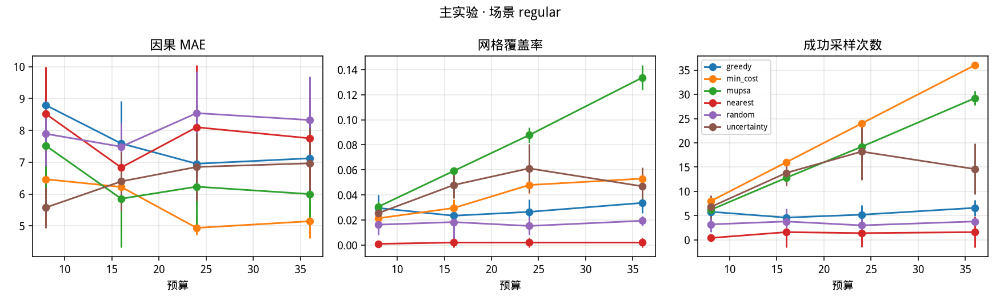

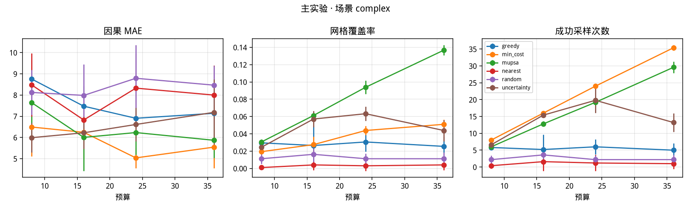

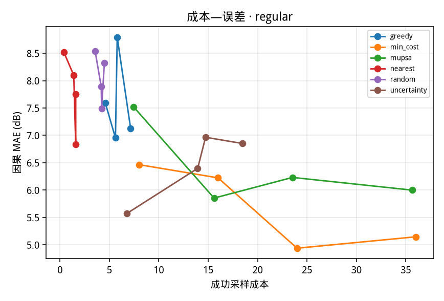

### 消融

complex、预算 24、5 个种子的平均因果 MAE：去掉重规划 6.319，去掉覆盖 6.576，完整 MU-PSA 6.816，去掉移动 7.748，去掉不确定性 8.149。去掉移动或不确定性变差，符合这两项进入分数的方式。去掉覆盖或重规划反而略好，所以不能写完整模型支配所有消融。可能的原因是覆盖项把样本拉向孤立格子，而这些格子对全场 MAE 的帮助小于在已有结构附近多采样。这是对结果的解释，不是新的定理。

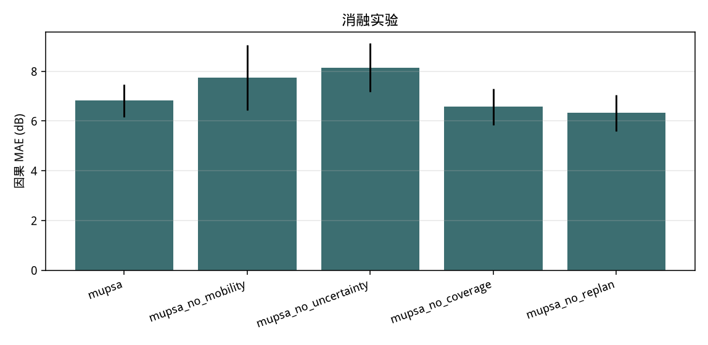

### 移动、人机和鲁棒性

主探测上的移动指标见第五章。动态实验的四种设置对应最近、最近、MU-PSA 和带到达阈值的 MU-PSA。最近方法几乎不利用历史。MU-PSA 利用预测。实验没有显示“只要用了预测，MAE 就一定更低”，因为最小成本匹配在高预算时误差更小，而它只把到达概率当作门槛。

鲁棒性只对 MU-PSA 报告，来自同一汇总文件：混合基线 MAE 5.867；人少 7.254；低接受率 8.341；移动偏移 7.418；传感器更吵 7.809；轨迹缺失 8.481；部分离线 7.961；只有人类 5.256；只有机器 8.806。只有人类时成功任务更多，因为人更便宜。只有机器时样本更少，而且巡逻集中在道路。出租车或机器轨迹在这里只是合成巡逻，不是 T-Drive 数据。

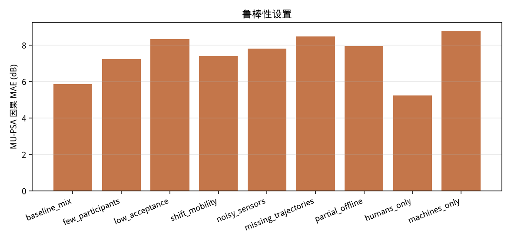

### LinUCB

训练 12 次的回报依次约为 59.3、34.1、53.9、53.2、80.6、35.9、61.2、93.7、71.7、71.0、22.2、54.0。没有稳定上升。

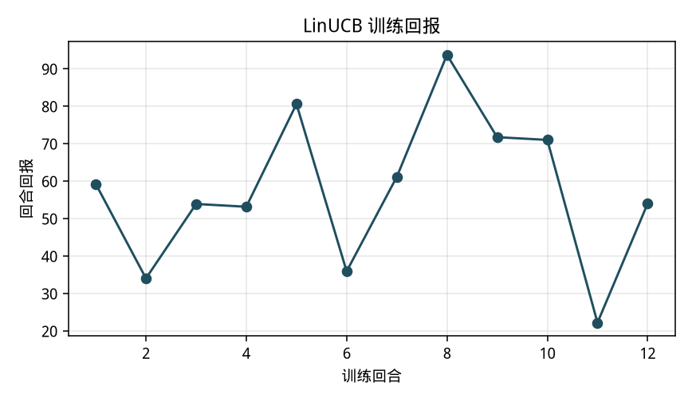

公平比较写在 `experiments/results/bandit_fair.json`。世界种子是 800 到 804，回合随机种子记录为 50000 到 50004，regular，预算 24，14×14，冻结的 LinUCB，测试时不更新。五次平均因果 MAE：bandit 5.056，uncertainty 5.801，min_cost 5.811，mupsa 5.830。bandit 的平均覆盖率 0.091，成功任务 24。这只说明在这一组和这一预算上，训练过的线性置信上界优于同场的三个对照。它不能改写主表，因为主表的种子和场景更多，而且主表没有把未训练的 bandit 混进去。

### 对假设的支持

移动预测和不确定性都进入分数之后，去掉其中一项会在上述消融里提高误差。这支持“这两项不是摆设”。它不支持“联合方法在所有预算上重建最准”。高到达概率和高覆盖可以与较高的 MAE 同时出现。失败机制是：可预测的巡逻点往往位于道路或固定路线，噪声结构已经比较清楚，再采样对全场误差帮助有限；便宜的人类即使到达概率一般，也可能因为样本数量降低误差。

## 第九章 系统测试

测试计划、结果、性能和已知问题分别在 `docs/testing`。2026-11-09 执行：

```bash
PYTHONPATH=src .venv/bin/python -m pytest -q --tb=line
```

11 项通过，约 2.4 秒。浏览器脚本退出码 0。性能探针中 16×16 的一次回合约 0.43 秒，分配接口约 22 毫秒。详见 `docs/testing/performance_report.md`。

修复过的错误包括：商业区被道路十字盖掉、IDW 时间距离过大导致新样本无法改变地图、仿真重复抽接受、手工任务被错误退款、实验线程在提交前启动、自动核验权限不足。这些都改在代码里，而不是改实验结果。

未解决项见 `docs/testing/known_issues.md`。其中 Docker 未执行和全量真实数据未下载是资源限制，不是隐藏的通过。

## 第十章 部署与使用

已验证：

```bash
cd /workspace
PYTHONPATH=src .venv/bin/python -m uvicorn urbannoise.api:app --host 127.0.0.1 --port 8000
cd apps/web && npm run dev -- --host 127.0.0.1 --port 5173
```

打开 `http://127.0.0.1:5173`。账号见第二章。`make demo` 会在空库时写入演示数据。`make test` 运行 pytest。`make experiment-smoke` 按 `experiments/configs/smoke.json` 重跑小实验。`make report` 由 Markdown 生成 PDF。

Docker Compose 文件在仓库根目录。本机没有 `docker` 命令，因此不能把 `docker compose up` 写成已验证命令。若在有守护进程的机器上运行，应先阅读 `deploy/README.md`，并准备接受镜像构建时间。数据库仍是容器内的 SQLite 文件，不是 PostGIS。

导入外部文件使用数据页。csv 按 YJMob 列解释，plt 按 GeoLife 解释，geojson 按噪声点解释。超过 20 MB 会被拒绝。最多保存 5000 行。这些行不会自动出现在虚拟城市地图上。

常见问题：登录 401 是口令错误；分配返回“没有满足约束的候选”是预算或到达概率把所有配对滤掉了；仿真采样 409 且提示不在网格上时，应改用手工测量或把时钟推到参与者确实经过的时间片。

## 第十一章 创新分析与局限

文献里已经有稀疏选点、移动可预测性和序贯任务分配。本项目的机制是把到达概率、接受概率、质量、启发式价值和成本写成一个可执行分数，并和基线放在同一因果协议下。机制差异见 `docs/research/innovation_analysis.md`。

消融说明移动项和不确定性项在所测复杂场景里降低了误差。主表说明这个分数不保证最低 MAE。因此毕业设计可以声称实现并检验了一个联合启发式，不能声称提出了被实验全面支持的新最优算法。

局限：合成城市的用地差异远大于用地内部起伏，所以少量样本就能把 MAE 从无采样时的较高水平降到大约 5–7 dB，方法之间的差距有一部分来自“多测一些便宜的人”而不是来自更精细的信息增益。真实噪声的仪器偏差、指标定义和缺失机制都没有进入主表。LinUCB 的训练用了仿真误差。区间没有校准。

后续工作应先在下载到的 YJMob 子集上重估移动模型，并单独做 NoiseCapture 城市的插值评估，而不是把两者画在同一张地图上。若要比较子模采样，需要换一个真正以预期误差下降为目标的价值函数，并证明预测器在评估时仍然看不到真值。

## 第十二章 总结

仓库里现在有可登录的测站、真实状态机、合成城市闭环、三种以上基线、MU-PSA、LinUCB、主实验图表、浏览器截图、UML 和本报告。MU-PSA 在 regular、预算 16 的五次平均里因果 MAE 最低；在预算 8、24、36 时不是最低。去掉移动预测或不确定性会使所测消融变差。这些句子都可以回到 JSON。

未完成的部分是 Docker 实跑、全量真实数据、Gymnasium/PPO、Alembic、已校准的概率区间，以及任何真实城市的时空联合实验。

## 附录 A 参考文献

完整条目在 `docs/research/references.bib`。正文提到的 DOI 均在 2026-11-09 用 Crossref 或 OpenAlex 核对过题名。没有全文确认的论文不引用其实验数字。

## 附录 B 复现

```bash
PYTHONPATH=src .venv/bin/python -m pytest -q
PYTHONPATH=src .venv/bin/python -m urbannoise.experiment --config experiments/configs/smoke.json
PYTHONPATH=src .venv/bin/python scripts/benchmark.py
node apps/web/e2e/walkthrough.mjs
```

主实验配置是 `experiments/configs/main.json`。公平 bandit 脚本是 `scripts/fair_bandit.py`。

## 附录 C 图片清单

系统截图在 `docs/screenshots`。UML 在 `docs/uml/png`。实验图在 `experiments/figures/main`。本报告引用了登录、总览、地图、任务、分配、轨迹、预测、仿真、实验、数据、管理、采集者、移动端、主实验、消融、鲁棒性、bandit 回报以及架构、类、ER 和流程图。这些文件都在仓库中，不是设计稿。
