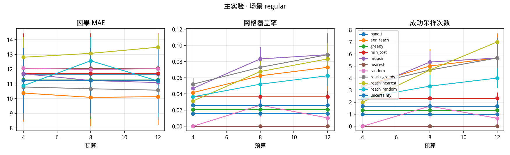
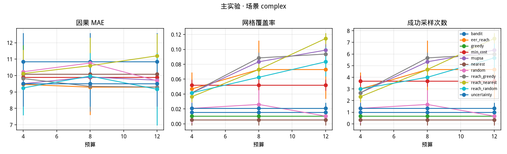
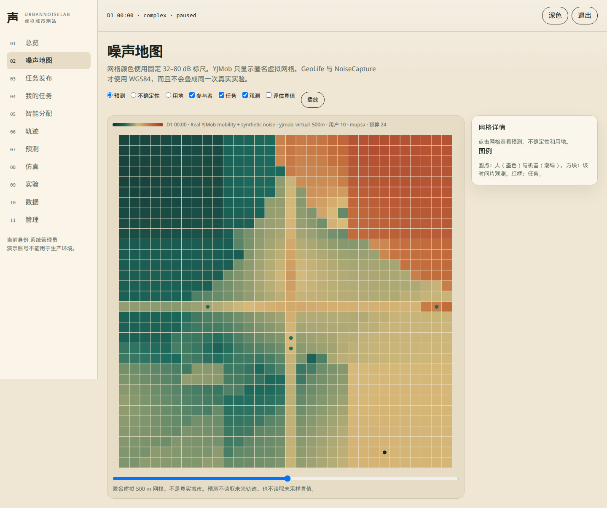
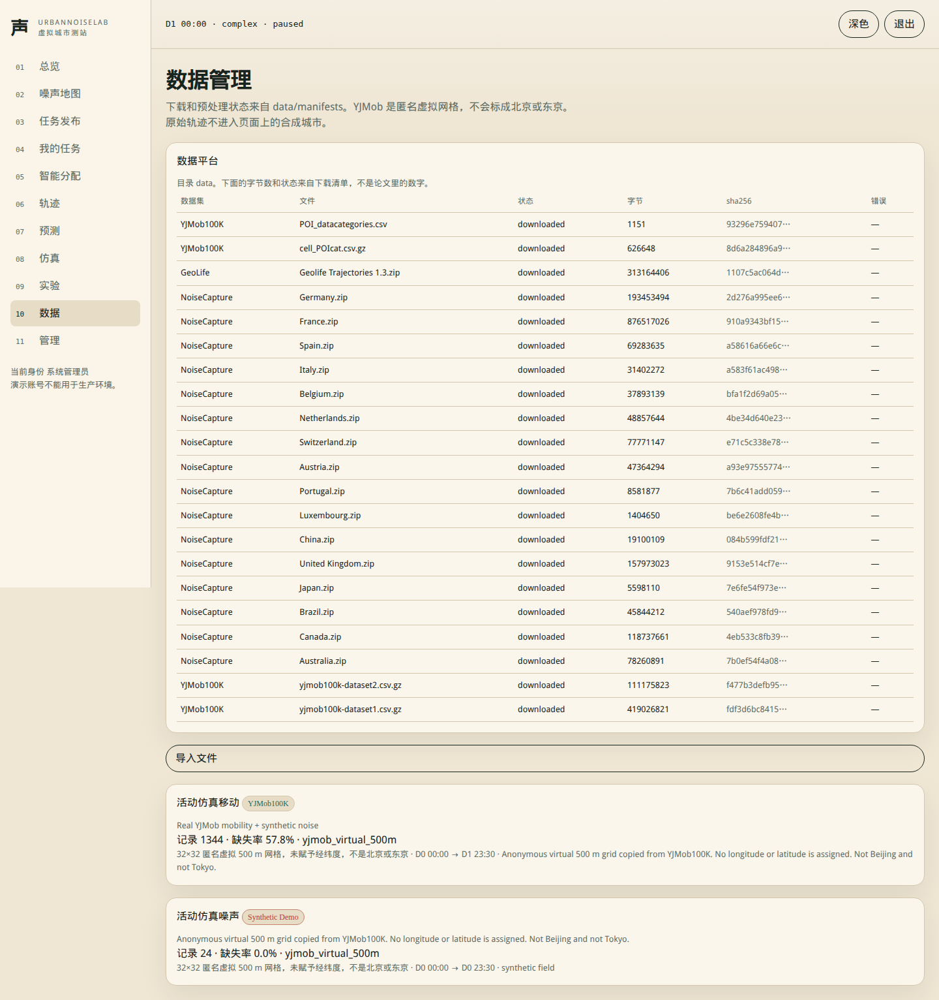
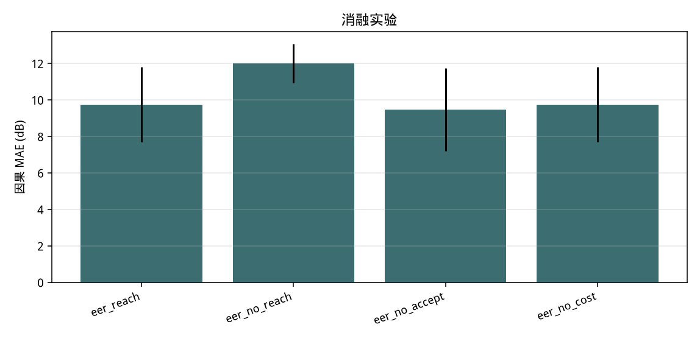
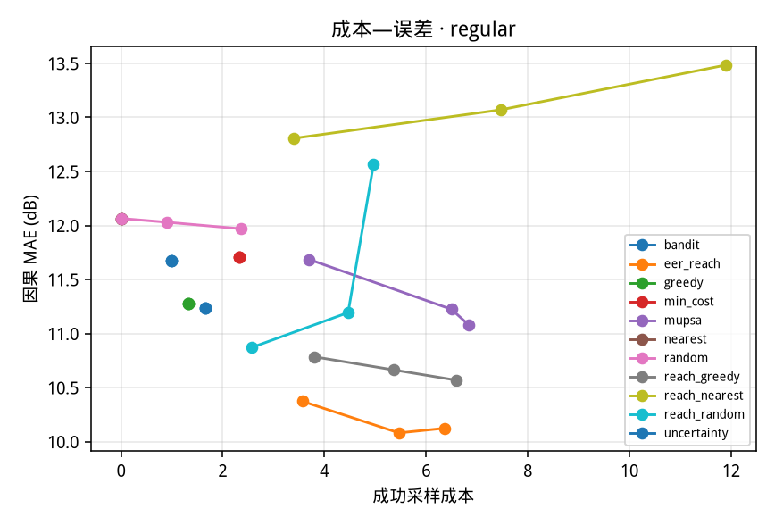
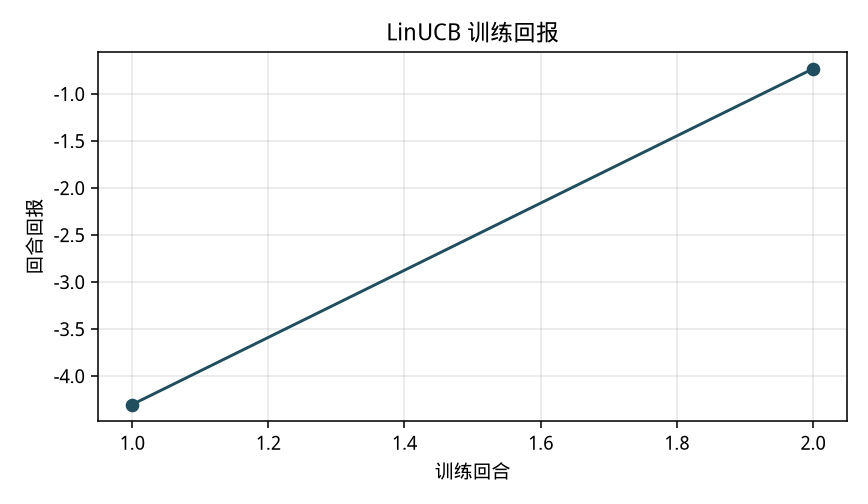
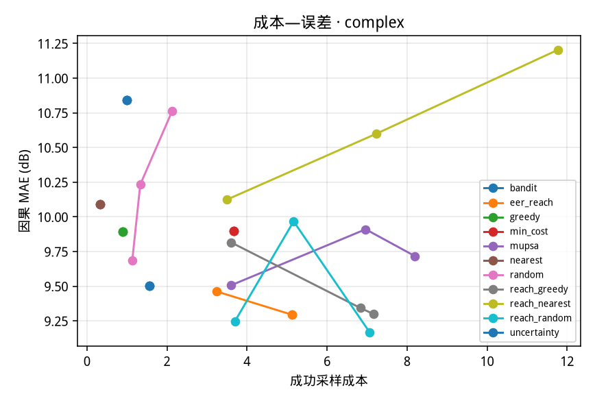

# UrbanNoiseLab Phase II 系统报告

本报告只记录这一次分支上实际运行过的代码、下载和实验。它不取代 `experiments/results/main` 里的旧协议数字，也不把 MU-PSA 或 `eer_reach` 说成每个预算的赢家。本系统没有被写成已获奖的论文。

## 1. 背景

系统要在预算内把人和机器派到网格上测噪声，并用已有观测更新预测。合成演示仍然叫 Synthetic Demo。YJMob100K 只有匿名的虚拟 500 m 网格，页面和元数据都不写北京或东京。GeoLife 使用 WGS84。NoiseCapture 是手机测量，不是连续的城市真值场。

评价协议的名字是 `mae_available_at_t`。在时刻 t 做决定时，预测只能使用时刻 t 及以前的观测和轨迹。真值只在三种地方出现：采样成功之后的测量反馈、明确允许披露的奖励，以及事后的误差计算。结果表里的旧列名 `mae_causal` 保存的是同一个数。

## 2. 文献和认识标签

2026-11-10 的 CDRI landscape 运行号是 `20261110-013339-joint-sampling-location-and-pa`，去重 537 条，来源是 arXiv、Crossref、DBLP、OpenAlex 和 Semantic Scholar，退出码 0。全局阅读账本是空的。下面的书目是 Verified Fact，方法细节如果只来自摘录，就标成摘录。

- Krause、Singh、Guestrin，2008，*Near-Optimal Sensor Placements in Gaussian Processes*，JMLR，DOI 10.5555/1390681.1390689。published。传感器放置，不是会拒绝任务的人。
- Mussmann 等，2022，*Active Learning with Expected Error Reduction*，arXiv:2211.09283。preprint。磁盘上有实验节摘录，任务是图像分类。
- Li、Zhao、Yu、Cheng、Lv，2022，*Harnessing Context for Budget-Limited Crowdsensing With Massive Uncertain Workers*，IEEE/ACM Trans. Networking，DOI 10.1109/tnet.2022.3169180。published。
- Cao、Low、Dolan，2013，*Multi-robot informative path planning for active sensing of environmental phenomena*，DOI 10.65109/frmm7982。published。磁盘上有引言摘录。

Agent Interpretation：分类误差下降和传感器互信息都不能原样搬进这个分配器。CDRI 把“标签一定被观测”和“任务是分类”标成 violated。Hypothesis 和负结果分别在 `docs/research/algorithm_hypotheses.md` 与 `docs/research/negative_results.md`。novelty 没有被证实，本报告不声称学术新颖性。

## 3. 需求

功能上要能切换合成世界、真实移动加合成噪声、真实噪声留出预测，以及在时空不重叠时拒绝 Fully-Real。同一场景、子集、时间范围和种子必须共享噪声场、轨迹、初始观测、机器资源、测量噪声和接受抽签。算法自己的随机数单独取。采集者不能看到当前时钟之后的轨迹，也不能打开真值层。

这些要求对应 `docs/requirements/requirements.md` 的 Phase II 表。Docker 不是需求的实现方式。

## 4. 架构

浏览器里的 React 应用把 `/api` 代理到 FastAPI。SQLite 保存用户、任务和当前仿真。`urbannoise.migrations` 在旧库上增加列，版本写在 `schema_migrations`，不删除行。大规模轨迹在 Parquet 中，用 DuckDB 过滤，不把 10 万用户乘 75 天展开成内存张量。

`resolve_world` 选择数据源。Synthetic 调用 `build_world`。Real-Mobility 把记录的格子抄进 `Agent.traj`，格子外保持 -1。Real-Noise 的 `laeq` 是 NaN。Fully-Real 先看 `overlap_report`。

图 1 是公平协议 regular 场景的 MAE 曲线，来源是这次运行写出的图。

## 5. 这次运行得到的数据

下载清单是 `data/manifests/download_manifest.json`。21 个文件状态都是 downloaded，字节数与磁盘大小一致。sha256 由下载脚本在写完文件后计算。详细表在 `docs/data/dataset_download_report.md`。

YJMob100K，Zenodo 10836269：

- dataset1：111535175 行，100000 个 user_id，day 0–74 共 75 天，timeslot 0–47，x 和 y 都是 1–200。文件 419026821 字节。
- dataset2：29389749 行，25000 个 user_id，天数和网格范围与 dataset1 相同。文件 111175823 字节。这个 25000 是预处理脚本的 distinct user_id，没有用记录页面上的描述替换它。
- 没有经纬度列。

GeoLife：`Geolife Trajectories 1.3.zip`，313164406 字节。解析出 18670 个 plt、182 个用户目录、24876978 个点、84742 个 30 分钟均值箱。原始包围盒的纬度最大值是 400.166666666667，不是合法纬度。箱内均值的纬度范围是 1.234 到 64.752，经度 -176.200 到 175.619。全局最忙的两天是 2009-02-14 和 2009-02-15，544 行、32 个用户。算法运行使用的是另一对日期，见第 11 节。

NoiseCapture：16 个国家 zip 都下完了。点测量 laeq_1s 共 62293431 行，轨迹级 laeq_track 222923 行，没有混用。小时 500 m 能量平均 204121 行。能量平均是 10*log10(mean(10^(L/10)))。France 点测量 29116920 行，时间从 2015-01-01 起。各国时间都晚于 GeoLife 的 2012-07-27，所以没有做 Fully-Real。

## 6. 移动

真实移动的成功条件是：该人在该时间片的记录格子等于任务格子。未来轨迹不会被改到任务上，也不会进入 `decision_context`。合成机器单独标记，不计入真实人数。

YJMob 先按 user_id 数值顺序取候选，再在这些点上取最密的窗口，最后留下窗口内点数够的人，最多 10 个。窗口之外的点保持缺失。

GeoLife 对合法经纬度重新按子集的最小纬度、经度做 500 m 等距圆柱网格，半径 6371000 m。请求 10 个人时，窗口里达到最少点数的是 8 个人。

## 7. 噪声

合成噪声场有真值，只用于采样反馈和事后 MAE。真实噪声没有连续真值。预测是时间留出：按 `hour_epoch` 的 0.7 分位切开，SQL 里最多取 4000 条训练和 1500 条测试，再用现有的 IDW。France 这次读入 114182 个小时箱，实际训练 4000、测试 1500，MAE 18.2598，RMSE 22.4131，R² -0.3516。R² 为负，表示比预测均值更差。Luxembourg 读入 204 行，训练 143，测试 61，MAE 15.5243，RMSE 20.7696，R² -0.4318。这不是全城场误差。

图 2 是 complex 场景的曲线。

## 8. 算法

预测标准差为 std，传感器标准差为 sensor_sigma。令 v = std²，r = sensor_sigma²。单格方差下降是 v² / (v + r)。`eer_reach` 在到达概率不小于 0.22 时计算：

P(reach) * P(accept) * quality * (v² / (v + r)) - 0.35 * cost

0.35 是原有系数，没有为了赢再搜索。式子不更新邻居格子。它不是互信息，也不是分类 EER。

对照方法使用同一套执行规则：random、nearest（当前位置最近，弱基线）、reach_nearest、reach_random、reach_greedy、greedy、uncertainty、min_cost、mupsa、LinUCB。消融去掉到达、接受或成本中的一项。

## 9. 实现

公平比较在 `fairness.py`。`environment_seed` 接受 budget 参数并故意忽略它。测量噪声和接受抽签按时间片、格子和人取键，不随调用顺序变化。算法探索用 `algorithm_seed`。

`run_suite` 拒绝写入 `experiments/results/main`、`smoke` 和 `checkpoints`，除非配置把 protocol 设为 `legacy_protocol`。这次没有那样做。

采集者的轨迹接口只返回当前时钟之前的槽。地图在请求未来槽时把槽夹回过去，并设置 `future_hidden`。真值层对采集者返回 403。

## 10. 界面

仿真页的模式会交给 `POST /api/simulation/control` 的 reset。Real-Mobility 使用 YJMob 或 GeoLife 的 Parquet，不是在 `build_world` 上改一个标签。数据页读取 `/api/data/platform`，表来自下载清单。实验页读取 `experiments/results/phase2/fair_main/summary.json`。旧协议文件只作为归档路径显示，不画进这张图。

地图对 `yjmob_virtual_500m` 写明匿名虚拟网格。GeoLife 与 NoiseCapture 不叠成同一次真实实验。下面两张图来自浏览器里的实际登录、切换和重置，文件在 `docs/screenshots/phase2/`。

图 3 是管理员看到的 YJMob 地图。图例写的是匿名虚拟 500 m 网格、10 个用户，不是北京或东京。

图 4 是数据页。行来自下载清单，包含 yjmob100k-dataset1.csv.gz 的字节数。

## 11. 实验

旧协议结果仍在 `experiments/results/main/summary.json`。那次比较里每个方法的 `episode_seed` 可以不同。例如 regular、预算 8 时 uncertainty 的 MAE 低于 mupsa。那些数字不能和下面的表相减。

公平协议配置是 `experiments/configs/phase2_fair.json`：网格 8，2 天，每天 6 个时间片，6 个人和 2 台机器，种子 0、1、2，预算 4、8、12。主表每个方法 3 次。MAE 是均值±样本标准差。

regular：

| 预算 | eer_reach | mupsa | 谁最低 |
| --- | --- | --- | --- |
| 4 | 10.3730±1.9314 | 11.6854±1.6820 | eer_reach |
| 8 | 10.0807±1.9651 | 11.2243±1.8611 | eer_reach |
| 12 | 10.1238±1.9079 | 11.0829±2.0545 | eer_reach |

complex：

| 预算 | 最低方法 | 最低 MAE | eer_reach | mupsa |
| --- | --- | --- | --- | --- |
| 4 | reach_random | 9.2482±1.6678 | 9.4633±1.5758 | 9.5066±1.4770 |
| 8 | eer_reach | 9.2940±1.6979 | 9.2940±1.6979 | 9.9107±1.0779 |
| 12 | reach_random | 9.1679±2.2074 | 9.2940±1.6979 | 9.7169±1.0500 |

complex 的预算 4 和 12 上，`eer_reach` 与 `mupsa` 都没有赢。`nearest` 在 regular 上的成功任务均值是 0 或 0.33。

消融是 regular、预算 8、3 个种子：`eer_no_accept` 9.4837±2.7795，低于完整的 `eer_reach` 9.7580±2.5184。接受概率项在这个切片上没有帮助。`eer_no_cost` 与完整式子相同，成本项没有改变选择。`eer_no_reach` 是 12.0173±1.3196，去掉到达概率后变差。

图 5 是消融图。

真实移动，预算 8，种子 0 和 1，每个种子上各方法共享环境哈希：

- YJMob dataset1，day 0–1，10 个真实用户，窗口内 125 行，24×24，96 个时间片。用户 id 为 1、102、105、116、120、124、130、134、144、153。最低是 min_cost 10.1624±4.8982。eer_reach 10.8701±4.8512。mupsa 10.9720±4.3656。
- YJMob dataset2，day 0–1，10 个用户，114 行。最低是 random 9.6565±1.7679。eer_reach 11.6025±1.4227，是这组里最高的。
- YJMob dataset2，day 60–61，10 个用户，134 行。最低是 nearest 8.0702±0.5932。eer_reach 9.8439±0.2870，也是这组里最高的。
- GeoLife，2008-11-01 与 2008-11-02，8 个真实用户，165 行。请求的是 10 个。最低是 min_cost 12.2390±2.5102。eer_reach 13.4918±1.0580。mupsa 13.4031±0.7992。

进入算法回合的真实用户数就是这些：10、10、10 和 8。合成机器每回合另有 1 台，不算真实用户。没有把 10 万用户整表放进回合。

图 6 是 regular 场景的成本与 MAE。

## 12. 测试

最后一次 `PYTHONPATH=src .venv/bin/python -m pytest -q --tb=line` 的结果是 21 passed、1 个 Starlette/httpx 弃用警告，用时 4.04s。Phase II 新增的测试包括：

- `test_shared_environment_hash_across_methods`
- `test_decision_does_not_read_future_truth_or_future_tracks`（原有）以及真实格子对照 `test_real_trajectory_cell_matches_source_frame`
- `test_yjmob_source_positions_match_and_are_not_wgs84`
- `test_geolife_subset_uses_real_bins`
- `test_budget_zero_unreachable_duplicate_expired_machine_offline`
- `test_real_noise_prediction_reads_noise_parquet_not_synthetic_demo`
- `test_real_noise_endpoint_does_not_fall_back_to_synthetic`
- `test_collector_cannot_read_future_trajectory_slots`
- `test_migration_adds_columns_without_deleting_rows`

YJMob 与 GeoLife 的测试在对应 Parquet 存在时运行，否则会 skip。这次它们通过了，因为文件存在。

## 13. 不使用 Docker 的运行

Linux 上执行的是 `scripts/setup_linux.sh`、`start_linux.sh`、`test_linux.sh` 和 `stop_linux.sh`。Windows 的四个 ps1 脚本已放在 `scripts/`。这台机器没有 PowerShell，那些脚本没有执行，也没有用 PowerShell 解析器做过语法检查。

SQLite 保存应用状态。Parquet 与 DuckDB 保存轨迹和噪声箱。`docker-compose.yml` 与两个 Dockerfile 标记为 UNUSED。

## 14. 局限

- `eer_reach` 只降低被测格子的方差，没有空间协方差。
- 公平合成实验的网格是 8×8、每天 6 个时间片、3 个种子。它不能代表更长的城市过程。
- 真实移动只放进了 8 到 10 个用户、两天和一个 24×24 窗口。
- 噪声预测使用小时箱的 SQL 样本。France 的 R² 为负。
- GeoLife 原始扫描混入了非法纬度。箱均值把它稀释了，但没有逐点重解析全部 plt。
- Fully-Real 没有联合回合。
- LinUCB 只训练了 2 个回合，而且额外预算没有带来更多成功采样。图 7 是这次日志画出的奖励曲线，不是调参后的结果。

- 文献阅读账本为空，不能把摘录写成全文方法证明。

图 8 是 complex 场景的成本与 MAE。

